# Informe del proyecto

## Modelo de aprendizaje automático para identificar patrones de contaminación y estimar el riesgo en sedimentos de Moquegua

**Documento explicativo del MVP**  
Fuente de datos: Registro de Monitoreos Ambientales del OEFA, matriz sedimento  
Periodo analizado: 2013–2026  
Muestras: 394 · Puntos de muestreo: 193 · Distritos: 7

---

## Contenido

1. [Resumen ejecutivo](#1-resumen-ejecutivo)
2. [Qué se buscó y por qué](#2-qué-se-buscó-y-por-qué)
3. [Cómo se trabajó: vista general](#3-cómo-se-trabajó-vista-general)
4. [Preparación de los datos](#4-preparación-de-los-datos)
5. [Análisis exploratorio y primeras señales](#5-análisis-exploratorio-y-primeras-señales)
6. [Medidas de contaminación](#6-medidas-de-contaminación)
7. [Clasificación de los niveles de riesgo](#7-clasificación-de-los-niveles-de-riesgo)
8. [Patrones de contaminación](#8-patrones-de-contaminación)
9. [Modelos supervisados](#9-modelos-supervisados)
10. [Explicación con SHAP](#10-explicación-con-shap)
11. [Zonas críticas](#11-zonas-críticas)
12. [Tablero, pruebas y reproducibilidad](#12-tablero-pruebas-y-reproducibilidad)
13. [Limitaciones](#13-limitaciones)
14. [Conclusiones](#14-conclusiones)
15. [Glosario breve](#15-glosario-breve)
16. [Anexo: figuras y archivos](#16-anexo-figuras-y-archivos)

---

## 1. Resumen ejecutivo

Este proyecto construye un **producto mínimo viable (MVP)** de aprendizaje automático para responder dos preguntas sobre los sedimentos de los cuerpos de agua de Moquegua:

1. **¿Qué patrones de contaminación existen?** Es decir, qué combinaciones de metales y otros parámetros tienden a aparecer juntas en las muestras.
2. **¿Qué riesgo tienen esas muestras y dónde se concentra?** Usando guías de calidad de sedimento y modelos predictivos.

El trabajo siguió el plan de tesis basado en **CRISP-DM** y conserva sus elementos centrales: métricas R²/RMSE/MAE, validación K-fold, interpretación con SHAP y localización de zonas críticas.

### Resultados principales

| Indicador | Resultado |
|---|---:|
| Muestras de sedimento en Moquegua | **394** |
| Puntos de muestreo normalizados | **193** |
| Periodo | **2013–2026** |
| Metales usados en los índices | **8**: As, Cd, Cr, Cu, Hg, Ni, Pb, Zn |
| PLI mediano | **2.44** |
| Muestras con PLI > 1 | **79.7 %** (314 de 394) |
| Muestras que exceden al menos un PEL | **66.5 %** (262 de 394) |
| Nivel de riesgo *Alto* o *Muy alto* | **66.5 %** (262 de 394) |
| Zonas críticas de 5 × 5 km | **15**, todas *Muy alto*; 12 en Carumas y 3 en Torata |
| Mejor modelo de regresión del PLI | **XGBoost**, R²(log) = **0.823 ± 0.043** |
| Mejor modelo de clasificación de excedencia del PEL | **Random Forest**, ROC-AUC = **0.971 ± 0.024** |
| Validación temporal (2024–2026) | R²(log) = **0.547**; ROC-AUC = **0.946** |
| Variables más influyentes | **Fe, Mo, Co, Tl, Sb** |

> **En una frase:** los sedimentos de Moquegua muestran una contaminación extendida y espacialmente concentrada, dominada por arsénico, cobre, mercurio y plomo; los modelos predicen bien el nivel de carga metálica usando el contexto geoquímico, y las zonas más críticas están en Carumas y Torata.

---

## 2. Qué se buscó y por qué

### 2.1 El problema ambiental

Los sedimentos de ríos y quebradas acumulan metales y otros contaminantes. A diferencia del agua, que cambia rápidamente, el sedimento funciona como una **memoria** de lo que ocurrió durante meses o años. Por eso es clave para detectar:

- fuentes de contaminación minera o geogénica;
- zonas donde los metales se acumulan;
- riesgos para los ecosistemas acuáticos;
- cambios a lo largo del tiempo.

Moquegua tiene una historia minera importante y una geología compleja. No todas las concentraciones altas son causadas por actividad humana: algunas pueden venir de la propia roca. Distinguir **enriquecimiento respecto al fondo local** de **excedencia respecto a una norma** es una decisión central de este proyecto.

### 2.2 Los objetivos concretos

El MVP busca:

1. **Preparar** el registro público del OEFA en una base limpia, una fila por muestra.
2. **Calcular índices** de contaminación y comparar con guías de calidad.
3. **Clasificar** las muestras en niveles de riesgo comprensibles.
4. **Identificar patrones** químicos con técnicas no supervisadas.
5. **Predecir** el PLI y la probabilidad de exceder el PEL con modelos supervisados.
6. **Explicar** las predicciones con SHAP.
7. **Localizar** puntos y zonas críticas.
8. **Comunicar** todo en un tablero y en este informe.

### 2.3 Qué significa “patrón” en este informe

Un **patrón de contaminación** no es un mapa ni una norma. Es una **firma química recurrente**: un grupo de muestras que, después de escalar sus concentraciones, se parecen entre sí y se diferencian de las demás.

Por ejemplo, un patrón puede ser “Pb–As–Fe–Ba” o “Zn–Cu–Cd–Ni”. Esas combinaciones sugieren procesos comunes —minería, geología, hidrotermalismo— pero **no prueban una causa**. Para probar causalidad haría falta trabajo de campo, isótopos, modelamiento de fuentes o estudios mineralógicos.

---

## 3. Cómo se trabajó: vista general

El proyecto sigue las seis fases de **CRISP-DM**:

```text
1. Comprensión del problema
        ↓
2. Comprensión de los datos  →  filtro Moquegua, revisión de calidad
        ↓
3. Preparación de los datos  →  limpieza R1–R10, formato ancho
        ↓
4. Modelado                  →  índices, clusters, modelos supervisados
        ↓
5. Evaluación                →  CV agrupada, hold-out temporal, SHAP
        ↓
6. Despliegue                →  mapas, tablero, informe, pruebas
```

Todo se ejecuta con un solo comando:

```bash
python run_pipeline.py
```

El pipeline guarda:

- `data/processed/`: datasets listos para analizar;
- `models/`: modelos entrenados;
- `reports/figures/`: figuras;
- `reports/tables/`: métricas y tablas;
- `reports/mapa_focos.html`: mapa interactivo;
- `reports/RESUMEN_MVP.md`: resumen automático.

---

## 4. Preparación de los datos

### 4.1 La fuente

El archivo original es `Monitoreos_SEDIMENTO.csv`, del **Organismo de Evaluación y Fiscalización Ambiental (OEFA)**. Tiene **257 092 filas** a nivel nacional y contiene **solo la matriz sedimento**: el filtro de matriz no eliminó ninguna fila.

Cada fila representa **una medición de un parámetro en una muestra**. Por eso el formato original es **largo**: una misma muestra aparece muchas veces, una vez por cada parámetro medido.

### 4.2 Filtro a Moquegua

Se aplicaron dos filtros:

| Etapa | Filas | Qué se hizo |
|---|---:|---|
| Registro nacional | 257 092 | Punto de partida |
| Matriz = sedimento | 257 092 | El archivo ya era de sedimento; no se eliminó ninguna fila |
| Departamento = Moquegua | **14 889** | Se conservó solo Moquegua |

**Decisión importante:** el filtro se aplicó sobre el **primer segmento** de `TXUBIGEO` (formato `DEPARTAMENTO, PROVINCIA, DISTRITO`), no sobre el ubigeo completo. El 26 % de las filas nacionales (66 680) tiene varios ubigeos separados por `/`. Entre ellas hay **10 372 filas de sedimento cuyo texto menciona Moquegua pero cuyo primer departamento es otro**: pertenecen a una supervisión que abarca Amazonas, Cajamarca, Lambayeque, Loreto y Piura, y sus coordenadas caen fuera de la caja UTM de Moquegua (0 de 10 372 dentro). Filtrar por el texto completo las habría incorporado y mezclado regiones.

### 4.3 Limpieza: reglas R1–R10

La limpieza se hizo con reglas explícitas y una bitácora que registra cuántas filas se eliminaron en cada paso. Esto es importante para la trazabilidad de la tesis.

| Regla | Qué hace | Filas antes | Filas después | Eliminadas |
|---|---|---:|---:|---:|
| R1 | Consolida las 12 columnas de valor en una sola columna `valor` | 14 889 | 14 889 | 0 |
| R2 | Normaliza nombres de parámetros y unidades a mg/kg | — | — | — |
| R3 | Marca valores bajo el límite de detección (`<`) | — | — | — |
| R4 | Descarta filas sin valor numérico | 14 889 | 14 889 | 0 |
| **R5** | **Descarta placeholders: valor 0 sin unidad y sin signo** | **14 889** | **12 834** | **2 055** |
| R6 | Excluye ensayos de lixiviación (mg/L) | 12 834 | 12 259 | 575 |
| R7a | Excluye unidades no convertibles | 12 259 | 12 254 | 5 |
| R7b | Excluye concentraciones negativas | 12 254 | 12 254 | 0 |
| R8 | Consolida duplicados (muestra, parámetro) | 12 254 | 12 254 | 0 |
| R9 | Valida coordenadas UTM (marca, no elimina) | — | — | — |
| R10 | Pivota a formato ancho: una fila por muestra | 12 254 | **394 muestras** | — |

#### El hallazgo más importante: los placeholders

El OEFA codifica algunas celdas vacías como `valor = 0`, **sin unidad y sin signo**. No son ceros reales: son filas “espejo” que duplican la medición verdadera.

Si no se eliminan:

- aparecen ceros falsos;
- se generan **208 duplicados conflictivos** (dos valores distintos para la misma muestra y parámetro);
- los índices se distorsionan.

La regla **R5** los elimina. Al hacerlo, los duplicados conflictivos desaparecen sin necesidad de promediar ni descartar muestras. Es una de las decisiones de calidad más relevantes del proyecto.

> **En palabras simples:** no se borraron datos reales; se borraron “celdas vacías disfrazadas de cero”.

#### Por qué se excluyeron los lixiviados

Los ensayos de lixiviación se reportan en **mg/L**, no en **mg/kg**. Miden otra cosa: la fracción que se disuelve en agua en condiciones de laboratorio. Mezclarlos con concentraciones totales de sedimento sería comparar peras con manzanas. Por eso se separaron (R6).

### 4.4 Dataset final

Después de la limpieza y el pivotaje:

- **394 muestras** de sedimento;
- **193 puntos de muestreo** normalizados;
- **107 columnas** en el dataset ancho (91 parámetros numéricos + metadatos);
- **47 parámetros** con cobertura ≥ 10 % (análisis descriptivo);
- **39 parámetros** con cobertura ≥ 60 % (modelado);
- **45 variables de entrada** en los modelos, incluyendo derivadas, coordenadas y tiempo.

Los nombres de los puntos se normalizaron para que variantes como `ESP-SED-01` y `ESP-SED-1` se consideren el mismo punto. Sin esto, la validación agrupada podría dejar el mismo punto en entrenamiento y prueba, inflando las métricas.

### 4.5 Distribución de las muestras

| Distrito | Muestras |
|---|---:|
| Carumas | 288 |
| Torata | 78 |
| Ichuña | 12 |
| Pacocha | 7 |
| El Algarrobal | 4 |
| Chojata | 3 |
| Ilo | 2 |
| **Total** | **394** |

| Año | Muestras |
|---|---:|
| 2013 | 1 |
| 2015 | 25 |
| 2017 | 31 |
| 2018 | 44 |
| 2019 | 53 |
| 2020 | 11 |
| 2021 | 10 |
| 2022 | 76 |
| 2023 | 80 |
| 2024 | 40 |
| 2025 | 16 |
| 2026 | 7 |

La distribución no es uniforme: **Carumas concentra el 73 %** de las muestras y hay más campañas en 2022–2023. Esto refleja el diseño del monitoreo del OEFA, que prioriza zonas de influencia minera, no un muestreo aleatorio de todo el departamento. Es una limitación importante para interpretar porcentajes.

---

## 5. Análisis exploratorio y primeras señales

Antes de modelar, se revisó la calidad y el comportamiento de las variables. Las figuras de esta sección no son “decoración”: cada una justifica una decisión posterior.

### 5.1 Cobertura de parámetros

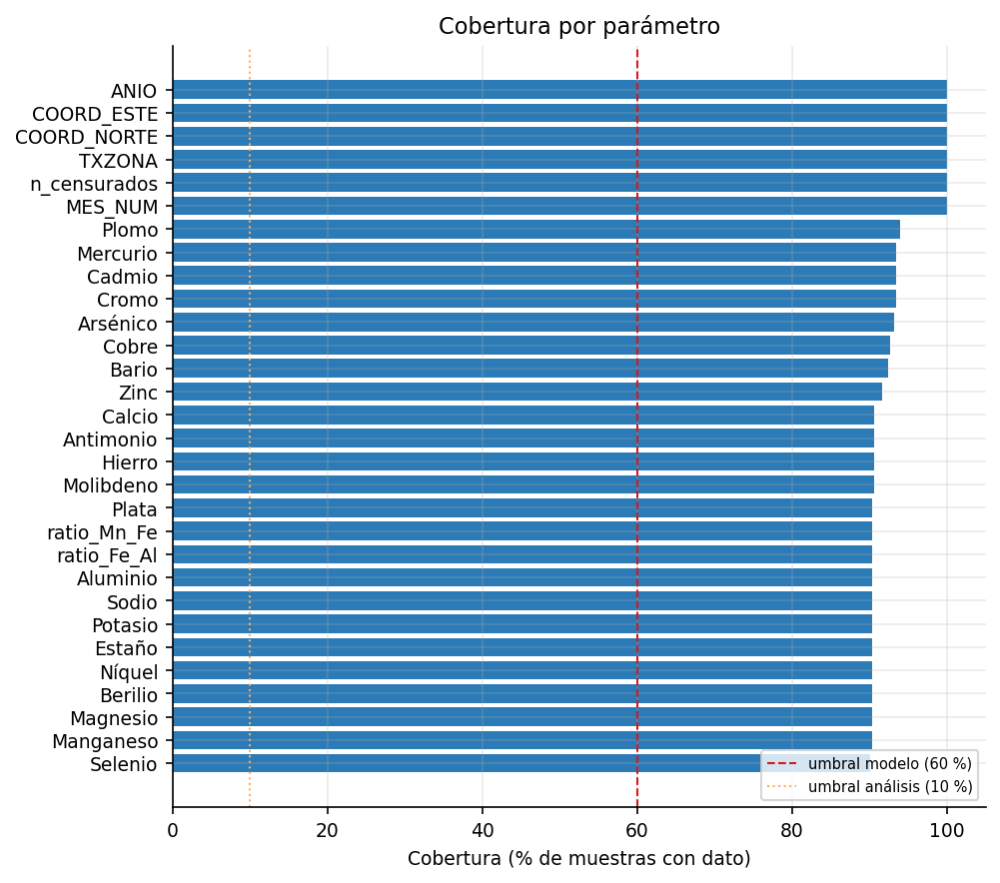

**Qué muestra.** Cada barra es el porcentaje de las 394 muestras que tiene un dato para ese parámetro. La línea roja marca el **60 %** exigido para entrar al modelo; la línea naranja, el **10 %** mínimo para el análisis descriptivo.

**Cómo se lee.**

- Los metales principales (Pb, Hg, Cd, Cr, As, Cu, Zn, Ni) y los elementos mayores (Fe, Al, Ca, Mg, Na, K, Ti) tienen coberturas cercanas al **90 %**. Son la base del análisis.
- Parámetros como Bi, Si, U, W, Th, Ce, sulfato o TPH tienen coberturas menores. Se usan en el análisis exploratorio, pero no todos entran al modelo.
- La figura muestra solo los 30 parámetros con mayor cobertura para que sea legible; la tabla completa está en `reports/tables/cobertura_parametros.csv`.

**Decisión que justifica.** No se puede construir un modelo estable con variables que existen en pocas muestras. Por eso se fijó un umbral de cobertura y se documentó explícitamente qué entra y qué no.

### 5.2 Censura: valores bajo el límite de detección

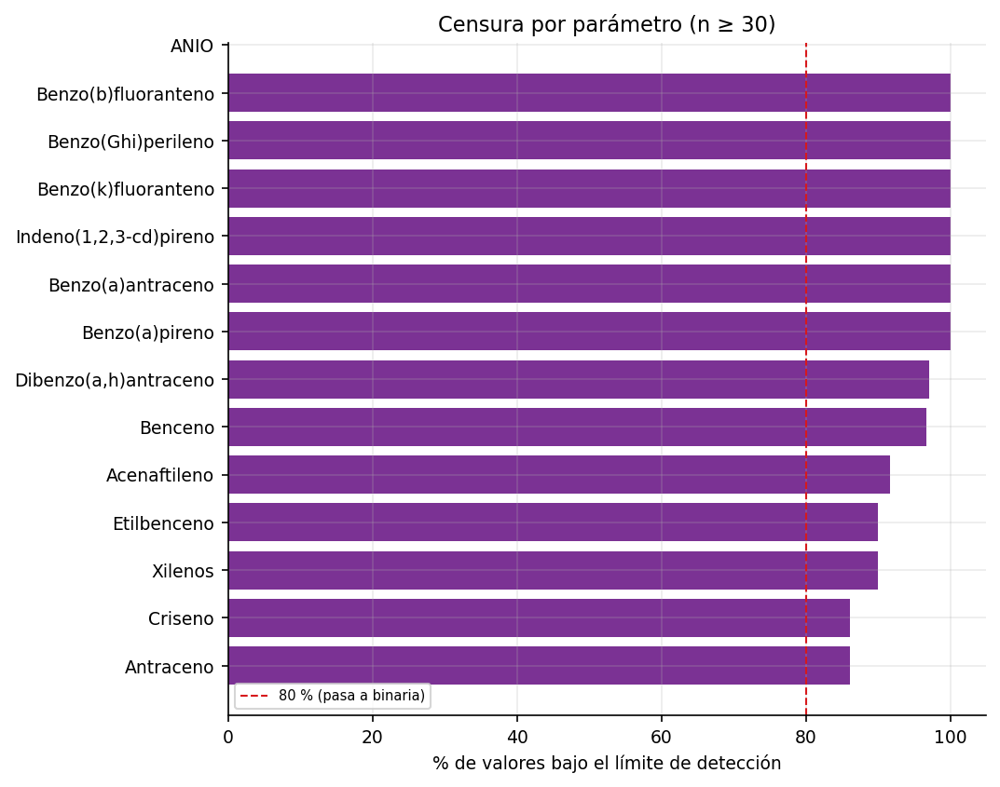

**Qué muestra.** El porcentaje de valores que el laboratorio reportó como “menor que” un límite de detección (`<`). La línea roja marca el **80 %**: por encima de ese valor, el parámetro se trata como binario (detectado / no detectado).

**Cómo se lee.**

- Varios PAH y BTEX tienen censura cercana al **100 %**. Son parámetros que casi nunca se detectan; sirven para decir “no detectado”, no para estimar concentraciones finas.
- En metales, la censura es más moderada: Hg 39.7 %, Sb 44.5 %, Tl 39.4 %, Ag 68.0 %, Sn 43.0 %, Se 30.4 %, Be 30.6 %, Cd 23.1 %, Li 21.1 %, Ni 14.9 %, As 11.7 %, Mo 14.6 %, Pb 6.8 %, Cr 4.3 %. Cu y Zn no tienen censura.
- La censura no es un error: es una característica normal de los laboratorios cuando la concentración es muy baja.

**Decisión que justifica.** El método principal reemplaza cada `<LD` por **LD/2**. Se probaron también LD/√2 y LD. Los resultados de PLI cambian poco: la mediana pasa de 2.445 a 2.303 y 2.344, y la correlación de rangos con el escenario principal es ≥ 0.9905. Es decir, las conclusiones no dependen de esta elección.

> **En palabras simples:** cuando el laboratorio dice “menos de 0.5”, no sabemos el valor exacto; usamos 0.25 como aproximación razonable y comprobamos que el resultado no cambie si usamos otra fracción.

### 5.3 Distribuciones de concentración

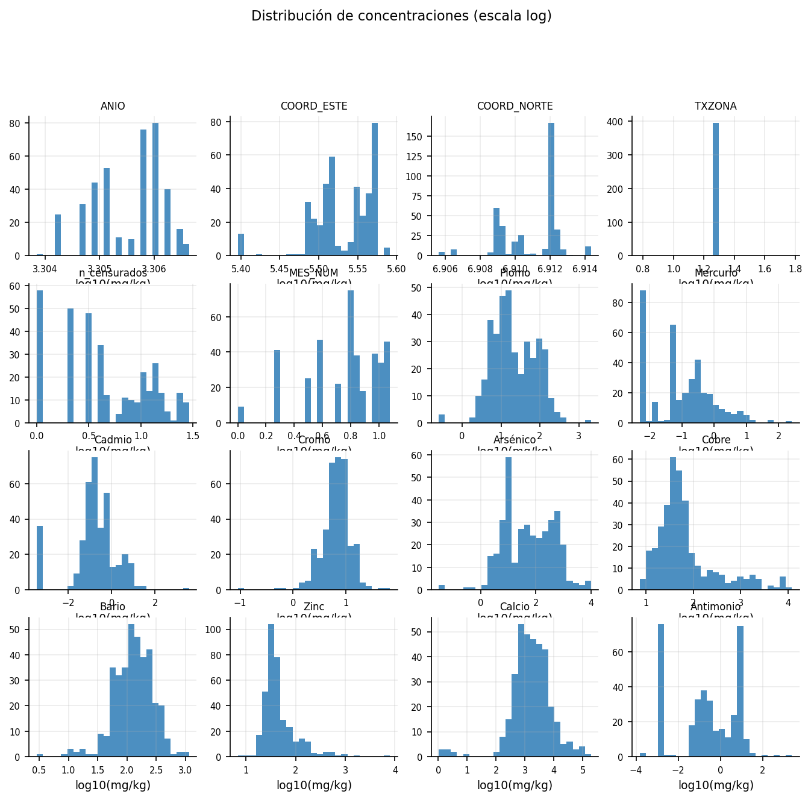

**Qué muestra.** Histogramas de 16 variables en escala **logarítmica**. La escala logarítmica es necesaria porque las concentraciones abarcan varios órdenes de magnitud: hay muestras con pocos mg/kg y otras con miles.

**Cómo se lee.**

- La mayoría de las variables tienen distribuciones **asimétricas a la derecha**: muchas muestras con valores bajos y pocas con valores muy altos.
- Esa asimetría es típica de datos ambientales y justifica usar **log1p** antes de modelar y de calcular distancias.
- Algunos picos aislados en el extremo izquierdo corresponden a valores censurados reemplazados por LD/2 (por ejemplo, Hg o Cd).
- La variable `ANIO` y las coordenadas aparecen solo como referencia; no son concentraciones.

**Decisión que justifica.** Los modelos lineales y el clustering son sensibles a escalas y valores extremos. La transformación logarítmica reduce esa influencia y hace más comparables las muestras.

### 5.4 Correlaciones entre contaminantes

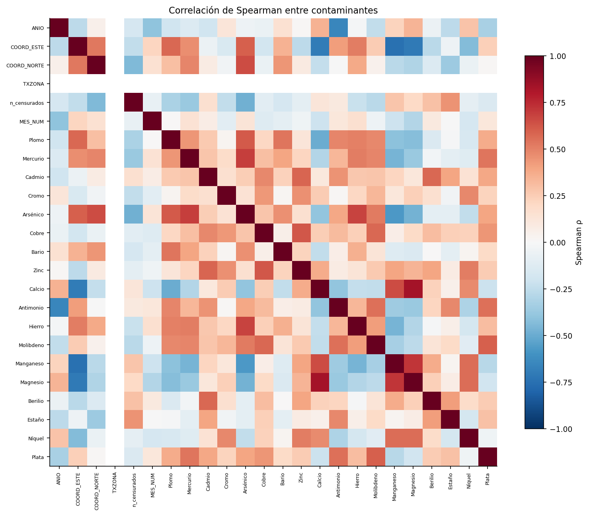

**Qué muestra.** La correlación de **Spearman** entre pares de variables. Spearman mide si dos variables tienden a subir o bajar juntas, sin exigir una relación lineal. Rojo = correlación positiva; azul = negativa.

**Cómo se lee.**

- Hay bloques de metales que covarían: **As, Pb, Cu, Hg, Cd** tienden a aparecer juntos en varias muestras. Eso sugiere fuentes o procesos comunes.
- **Fe, Al, Mn** y los elementos mayores forman otro bloque, ligado a la mineralogía y a los silicatos.
- **Ca y Mg** correlacionan entre sí, lo que refleja fases carbonatadas o evaporíticas.
- **Cr** muestra correlaciones más débiles: se comporta de forma más independiente.
- La correlación no implica causalidad; solo indica asociación.

**Decisión que justifica.** La existencia de bloques de metales apoya la idea de que hay **patrones** y no solo contaminación aislada de un elemento. También anticipa que el arsénico, el plomo y el cobre van a ser importantes en los índices.

---

## 6. Medidas de contaminación

Esta sección explica **cómo se midió** la contaminación. Se usaron cuatro índices clásicos y una comparación normativa.

### 6.1 Fondo geoquímico local (Bn)

Para saber si una concentración es “alta”, hay que compararla con un valor de referencia. Ese valor se llama **fondo geoquímico** (`Bn`).

En este proyecto se usó el **percentil 25 (P25)** de las propias muestras de Moquegua para cada metal. La idea es representar el nivel “habitual” o “de fondo” de la cuenca, sin depender de promedios globales que no reflejan la geología local.

| Metal | Bn local (mg/kg) |
|---|---:|
| Arsénico (As) | 8.750 |
| Cadmio (Cd) | 0.0784 |
| Cromo (Cr) | 4.897 |
| Cobre (Cu) | 28.700 |
| Mercurio (Hg) | 0.0150 |
| Níquel (Ni) | 2.500 |
| Plomo (Pb) | 8.235 |
| Zinc (Zn) | 29.200 |

**Por qué P25 y no la corteza promedio.** La corteza de Turekian & Wedepohl (1961) es una referencia global. Moquegua tiene una geología distinta, con aportes volcánicos y mineralizados. Usar la corteza puede subestimar o sobreestimar el enriquecimiento local. El P25 local es una aproximación más realista.

**Sensibilidad.** Se probaron P10, P25, P50 y corteza:

| Escenario | PLI mediano | % PLI > 1 | Spearman vs P25 |
|---|---:|---:|---:|
| P10 | 5.152 | 89.6 % | 0.9998 |
| **P25 (principal)** | **2.445** | **79.7 %** | **1.0000** |
| P50 | 1.088 | 49.0 % | 0.9997 |
| Corteza | 0.762 | 37.6 % | 0.9972 |

La **correlación de rangos es casi perfecta** (≥ 0.997). El valor absoluto del PLI cambia con el fondo, pero el orden de las muestras se mantiene. Eso significa que las zonas críticas y el ranking no dependen de una elección arbitraria del fondo.

### 6.2 Factor de contaminación (CF)

Para cada metal `i`:

```text
CF_i = C_i / Bn_i
```

Donde `C_i` es la concentración medida y `Bn_i` el fondo local.

**Interpretación:**

- `CF ≈ 1`: concentración similar al fondo.
- `CF > 1`: enriquecimiento respecto al fondo.
- `CF > 3`: enriquecimiento alto.
- `CF > 6`: enriquecimiento muy alto.

El CF es útil para detectar anomalías relativas. Pero tiene una limitación: **sobrepondera metales con fondo muy bajo**. Por ejemplo, el mercurio tiene un fondo de 0.015 mg/kg; una concentración pequeña en términos absolutos puede producir un CF enorme.

Por eso el proyecto conserva dos lecturas:

| Columna | Definición | Para qué sirve |
|---|---|---|
| `metal_dominante` | Metal con mayor **CF** | Detectar enriquecimiento respecto al fondo |
| `metal_dominante_normativo` | Metal con mayor **C/PEL** (o C/ISQG) | Responder a la pregunta regulatoria |

El ranking, las zonas críticas, el mapa y el tablero usan la **segunda** lectura. Es la más adecuada para decidir qué metal presiona más la norma.

### 6.3 Índice de geoacumulación (Igeo)

```text
Igeo_i = log2( C_i / (1.5 · Bn_i) )
```

El factor 1.5 corrige variaciones naturales del fondo. El Igeo se clasifica en 7 clases:

| Igeo | Clase | Interpretación |
|---:|---|---|
| ≤ 0 | 0 | Sin contaminación |
| 0–1 | 1 | De no contaminado a moderado |
| 1–2 | 2 | Moderado |
| 2–3 | 3 | De moderado a fuerte |
| 3–4 | 4 | Fuerte |
| 4–5 | 5 | De fuerte a muy fuerte |
| > 5 | 6 | Muy fuerte |

En el dataset, el **Igeo máximo** tiene mediana **3.85** y 136 muestras alcanzan clase 6 (muy fuerte). Es una señal consistente con el PLI, pero el Igeo se usa como indicador complementario, no como clasificación principal.

### 6.4 Índice de carga de contaminación (PLI)

El PLI resume el enriquecimiento de varios metales en un solo número:

```text
PLI = (∏ CF_i)^(1/n) = exp( (1/n) · Σ ln(CF_i) )
```

Es la **media geométrica** de los factores de contaminación. Se calcula solo si hay al menos **4 de los 8 metales**; con menos, el índice no es representativo y queda como faltante.

**Interpretación clásica:**

| PLI | Nivel |
|---:|---|
| ≤ 1 | Bajo |
| 1–2 | Medio |
| 2–3 | Alto |
| > 3 | Muy alto |

**Resultados:**

- PLI mediano: **2.445**.
- Media: 3.761; desviación estándar: 3.723.
- Rango: 0.189–20.977.
- Percentil 90: 7.88; percentil 95: 11.91.
- 314 de 394 muestras (79.7 %) tienen PLI > 1.
- Entre las 370 muestras con PLI calculable, 84.9 % supera 1.

Distribución por categoría de PLI:

| Nivel PLI | Muestras | % de 370 |
|---|---:|---:|
| Bajo | 56 | 15.1 % |
| Medio | 101 | 27.3 % |
| Alto | 48 | 13.0 % |
| Muy alto | 165 | 44.6 % |
| Sin dato | 24 | — |

El PLI es útil como **variable continua** y como objetivo de regresión. Pero no es la mejor forma de clasificar riesgo, porque con 79.7 % de muestras > 1 la categoría “alto” deja de discriminar. Eso se explica en la sección 7.

### 6.5 Índice de riesgo ecológico (RI)

```text
RI = Σ (Tr_i · CF_i)
```

`Tr_i` es el factor de respuesta tóxica de Hakanson (1980):

| Metal | Tr |
|---|---:|
| Hg | 40 |
| Cd | 30 |
| As | 10 |
| Cu | 5 |
| Ni | 5 |
| Pb | 5 |
| Cr | 2 |
| Zn | 1 |

El RI pondera el enriquecimiento por la toxicidad relativa. En el dataset:

- RI mediano: **908**.
- Rango: 14.7–1 397 050.
- 201 muestras en categoría “muy alto” según los cortes de Hakanson.

El RI es muy sensible a los valores extremos de Hg y Cd, porque tienen factores tóxicos altos. Por eso se reporta como indicador complementario y **no** se usa para la clasificación normativa.

### 6.6 Comparación con guías de calidad (ISQG y PEL)

Además de los índices, se comparó cada metal con las guías **CCME** de agua dulce:

- **ISQG** (*Interim Sediment Quality Guideline*): nivel de efecto umbral. Por encima, puede haber efectos adversos.
- **PEL** (*Probable Effect Level*): nivel de efecto probable. Por encima, es más probable que ocurran efectos.

| Metal | ISQG (mg/kg) | PEL (mg/kg) |
|---|---:|---:|
| As | 5.9 | 17.0 |
| Cd | 0.6 | 3.5 |
| Cr | 37.3 | 90.0 |
| Cu | 35.7 | 197.0 |
| Hg | 0.17 | 0.486 |
| Ni | 20.9 | 51.6 |
| Pb | 35.0 | 91.3 |
| Zn | 123.0 | 315.0 |

**Nota sobre el níquel.** CCME no publica ISQG/PEL para níquel. Se usó el complemento **NOAA ERL/ERM** (20.9 / 51.6 mg/kg), documentado en `config/guias_calidad.csv`.

### 6.7 Resultados por metal

| Metal | n | Mediana (mg/kg) | P90 (mg/kg) | Máximo (mg/kg) | % > ISQG | % > PEL |
|---|---:|---:|---:|---:|---:|---:|
| Arsénico | 367 | 49.40 | 694.2 | 10 000 | **88.0** | **64.6** |
| Cadmio | 368 | 0.165 | 3.33 | 3 649 | 21.2 | 9.0 |
| Cromo | 368 | 6.81 | 12.61 | 68.0 | 0.5 | 0.0 |
| Cobre | 365 | 46.30 | 619.7 | 12 091 | **65.2** | **17.3** |
| Mercurio | 368 | 0.100 | 1.582 | 257.0 | **42.7** | **21.2** |
| Níquel | 356 | 4.23 | 9.95 | 108.6 | 1.1 | 0.6 |
| Plomo | 370 | 17.40 | 123.4 | 2 061 | **35.4** | **17.3** |
| Zinc | 361 | 37.60 | 131.0 | 7 957 | 10.8 | 3.6 |

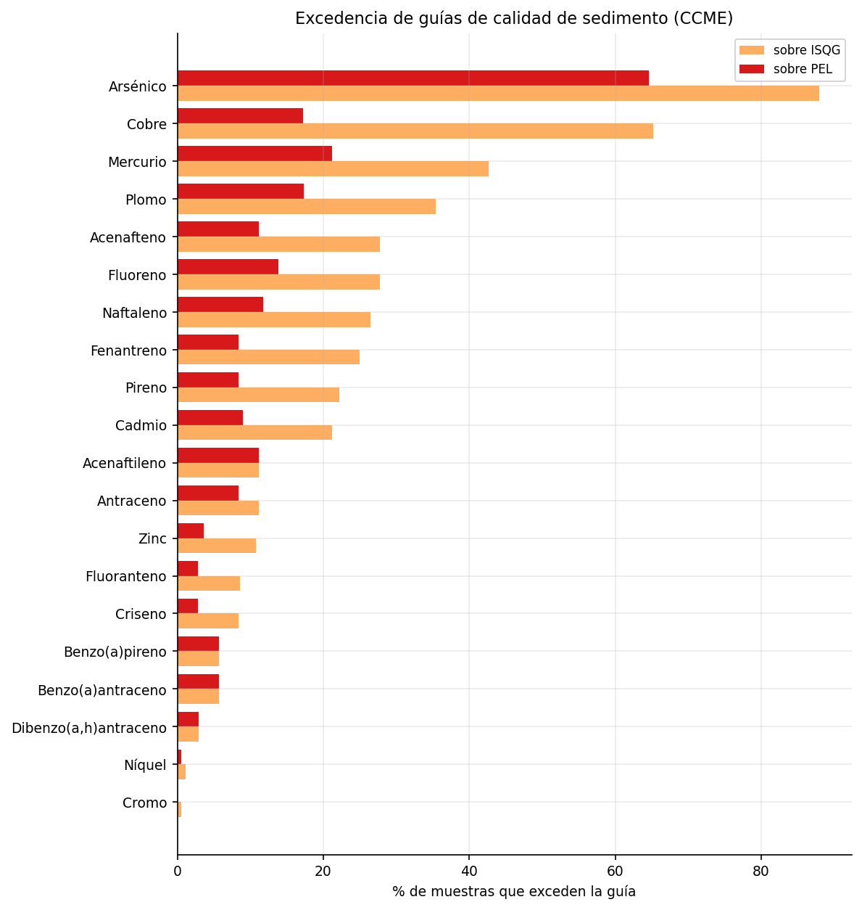

**Qué muestra.** Para cada parámetro con guía, el porcentaje de muestras que supera ISQG (naranja) y PEL (rojo). Las barras están ordenadas por excedencia de ISQG.

**Cómo se lee.**

- El **arsénico** es el contaminante más extendido: 88.0 % supera ISQG y 64.6 % supera PEL.
- El **cobre** le sigue en excedencia de ISQG (65.2 %), aunque su excedencia de PEL es menor (17.3 %).
- El **mercurio** tiene 42.7 % > ISQG y 21.2 % > PEL; es preocupante por su alta toxicidad.
- El **plomo** tiene 35.4 % > ISQG y 17.3 % > PEL.
- **Cadmio** y **zinc** tienen excedencias menores pero no despreciables.
- **Cromo** y **níquel** casi no exceden las guías.
- Los **PAH** aparecen en la figura, pero tienen solo ~35 muestras y una censura muy alta. Se usan como exploración, no para el nivel de riesgo.

**Decisión que justifica.** La comparación normativa es la base del nivel de riesgo. El PLI dice “cuánto se enriqueció el conjunto”; las guías dicen “qué metal está en una zona de efecto probable”. Para gestión ambiental, la segunda lectura es más directa.

---

## 7. Clasificación de los niveles de riesgo

### 7.1 Por qué no usar solo PLI

La guía original proponía clasificar el riesgo con umbrales de PLI. Con estos datos, eso es problemático: **79.7 % de las muestras tiene PLI > 1**. Si “PLI > 1” fuera “riesgo alto”, casi todo el departamento sería alto y la categoría perdería capacidad de discriminación.

Por eso se construyó una escala **anclada en las guías CCME**, que responde a una pregunta más útil: ¿cuántos metales superan el umbral de efecto y cuántos superan el nivel de efecto probable?

### 7.2 Criterios

| Nivel | Criterio | Muestras | % de 394 |
|---|---|---:|---:|
| **Bajo** | Ningún metal > ISQG | 19 | 4.8 % |
| **Medio** | ≥ 1 metal > ISQG, pero ninguno > PEL | 89 | 22.6 % |
| **Alto** | ≥ 1 metal > PEL, pero menos de 3 | 199 | 50.5 % |
| **Muy alto** | ≥ 3 metales > PEL | 63 | 16.0 % |
| **Sin dato** | Sin metales del índice | 24 | 6.1 % |

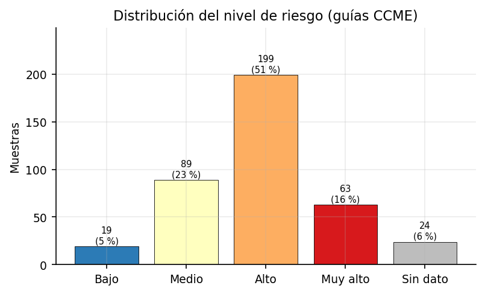

**Qué muestra.** El número de muestras en cada nivel. Los porcentajes se calculan sobre las 394 muestras.

**Cómo se lee.**

- La mitad de las muestras (199, 50.5 %) está en **Alto**.
- 63 muestras (16.0 %) están en **Muy alto**.
- Solo 19 muestras (4.8 %) están en **Bajo**.
- 24 muestras (6.1 %) no tienen metales suficientes para calcular el nivel.

> **En palabras simples:** el riesgo no es un sí/no. La escala distingue entre “hay señal de efecto” (Medio), “hay un metal en nivel probable de efecto” (Alto) y “hay varios metales en ese nivel” (Muy alto). Esa graduación es más útil para priorizar.

### 7.3 Riesgo por distrito

| Distrito | Bajo | Medio | Alto | Muy alto | Sin dato | Total |
|---|---:|---:|---:|---:|---:|---:|
| Carumas | 14 | 43 | 162 | 57 | 12 | 288 |
| Torata | 5 | 33 | 28 | 6 | 6 | 78 |
| Ichuña | 0 | 8 | 4 | 0 | 0 | 12 |
| Pacocha | 0 | 5 | 2 | 0 | 0 | 7 |
| Chojata | 0 | 0 | 3 | 0 | 0 | 3 |
| El Algarrobal | 0 | 0 | 0 | 0 | 4 | 4 |
| Ilo | 0 | 0 | 0 | 0 | 2 | 2 |
| **Total** | **19** | **89** | **199** | **63** | **24** | **394** |

Carumas concentra la mayor cantidad de muestras en **Muy alto** (57) y en **Alto** (162). Torata tiene un patrón más mixto: 33 en Medio, 28 en Alto y 6 en Muy alto. Ichuña y Pacocha se ubican principalmente en Medio. El Algarrobal e Ilo no tienen metales del índice en las muestras disponibles.

### 7.4 Mapas de riesgo

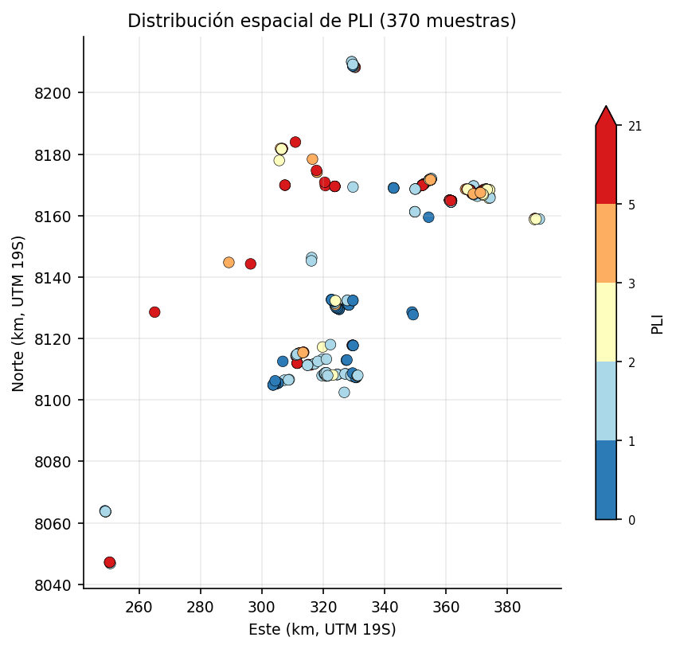

**Qué muestra.** Cada punto es una muestra, ubicada por coordenadas UTM 19S. El color representa el PLI, con una escala que va de 0 a 21.

**Cómo se lee.**

- Los valores más altos (rojo) se concentran en el **norte de Carumas**, alrededor de las coordenadas 370–375 km Este y 8165–8170 km Norte.
- Hay otro grupo de valores altos en **Torata**, cerca de 310–320 km Este y 8110–8120 km Norte.
- El sur (Ilo, Pacocha) tiene valores más bajos o sin dato.
- La superposición de puntos indica que varias muestras comparten la misma zona; no es un mapa continuo.

**Precaución.** El mapa no interpola superficies de riesgo. Solo muestra dónde están las muestras. Una zona sin puntos no significa “zona limpia”: significa “zona no muestreada”.

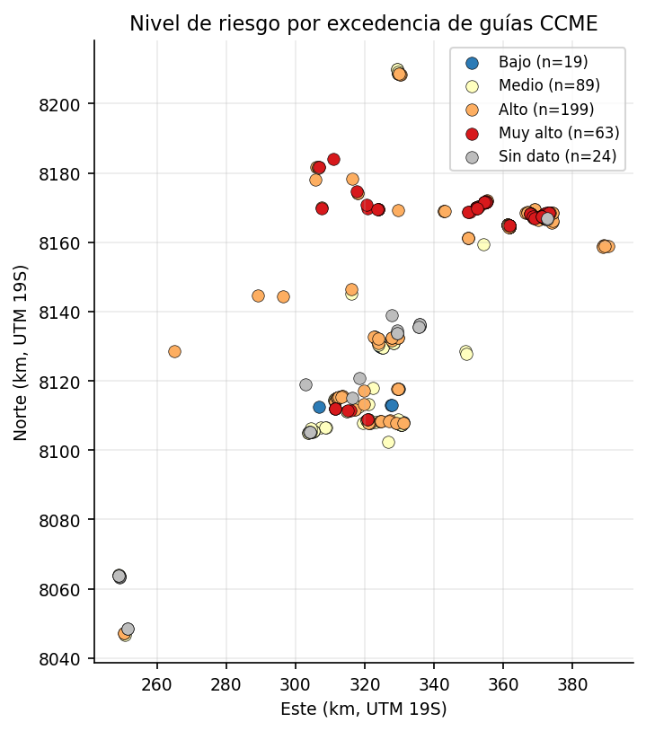

**Qué muestra.** La misma ubicación, pero coloreada por el **nivel de riesgo normativo**: azul = Bajo, amarillo = Medio, naranja = Alto, rojo = Muy alto, gris = Sin dato.

**Cómo se lee.**

- El patrón espacial es consistente con el mapa de PLI: Carumas y Torata concentran los rojos y naranjas.
- Hay puntos rojos aislados fuera de los grupos principales; son muestras puntuales que deben verificarse.
- Los grises se concentran en el sur y en algunas zonas sin metales del índice.

### 7.5 Evolución temporal

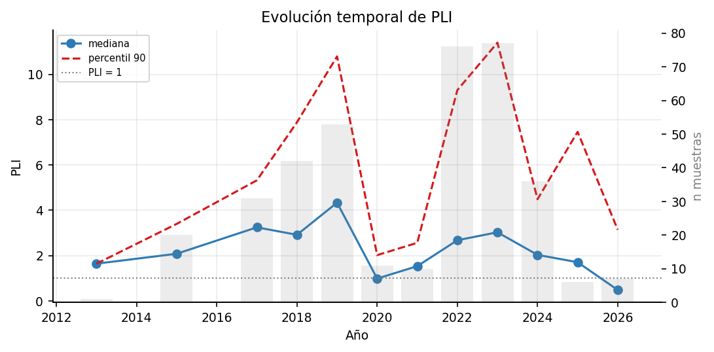

**Qué muestra.** La línea azul es la **mediana anual** del PLI; la línea roja punteada, el **percentil 90** (los valores altos); las barras grises, el número de muestras por año.

**Cómo se lee.**

- La mediana sube de 2013 a 2019, con un máximo en **2019 (4.34)**.
- En 2020–2021 baja (0.99 y 1.54), pero con pocas muestras.
- En 2022–2023 vuelve a subir (2.68 y 3.03).
- En 2024–2026 baja, pero 2026 tiene solo 7 muestras y no permite concluir una tendencia.
- El percentil 90 muestra episodios de valores muy altos, especialmente en 2019 y 2023.

**Precaución.** Las campañas no son un monitoreo continuo de los mismos puntos. Los cambios pueden reflejar **qué sitios se muestrearon** más que una mejora o empeoramiento real. Para hablar de tendencia haría falta un diseño longitudinal con puntos fijos.

### 7.6 Comparación entre distritos

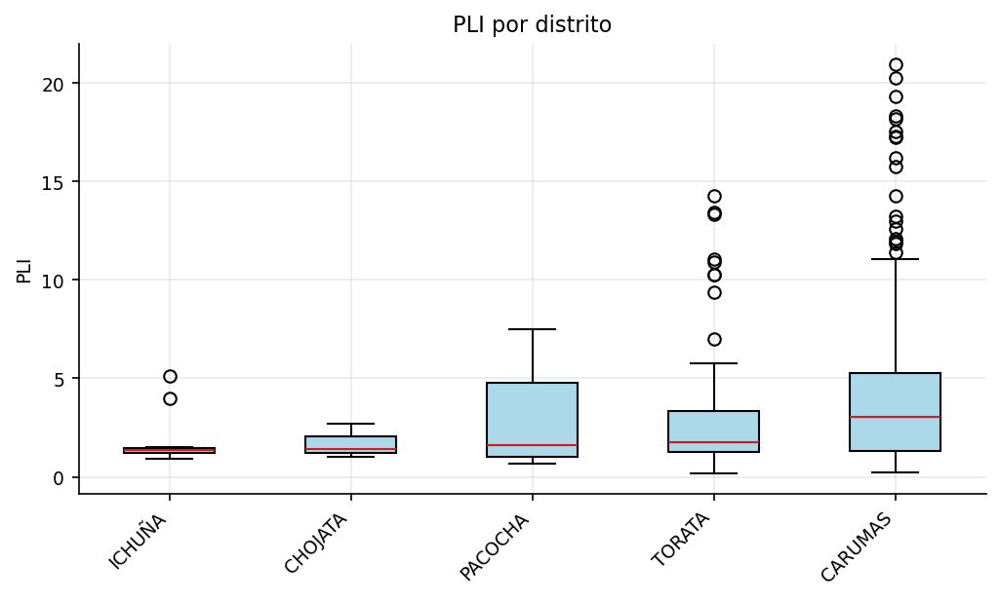

**Qué muestra.** Diagramas de caja del PLI por distrito. La caja contiene el 50 % central de los datos (percentiles 25–75); la línea roja es la mediana; los bigotes se extienden hasta 1.5 veces el rango intercuartílico; los círculos son valores atípicos.

**Cómo se lee.**

- **Carumas** tiene la mediana más alta (3.06) y la mayor dispersión, con valores extremos hasta 20.98.
- **Torata** tiene mediana 1.77, pero también valores altos aislados.
- **Pacocha** (1.61), **Chojata** (1.43) e **Ichuña** (1.34) tienen medianas más bajas.
- La dispersión dentro de cada distrito es grande: no todos los puntos de Carumas son iguales.

**Decisión que justifica.** El distrito es una unidad administrativa útil, pero no suficiente para localizar focos. Por eso después se agrega por celdas de 5 × 5 km.

---

## 8. Patrones de contaminación

### 8.1 Qué se hizo

Para identificar patrones se usó **aprendizaje no supervisado**: el algoritmo no conoce el nivel de riesgo ni el PLI; solo ve las concentraciones y agrupa las muestras parecidas.

Se seleccionaron **30 variables químicas** con cobertura suficiente. Se excluyeron:

- año, mes, coordenadas, zona y número de censurados (son contexto, no química);
- PLI, RI, CF, Igeo y ratios derivados (son índices, no concentraciones).

Luego:

1. Se aplicó **log1p** a las concentraciones.
2. Se imputó la mediana de cada variable.
3. Se estandarizó (media 0, desviación 1) para que ninguna variable domine por su escala.
4. Se aplicó **PCA** solo para visualizar en 2D.
5. Se aplicó **K-Means** con k = 2…8 y se eligió k por **silueta**.
6. Se aplicó **GMM** como contraste, eligiendo k por **BIC**.
7. Se detectaron anomalías con **Isolation Forest**.

### 8.2 PCA: el mapa de similitud química

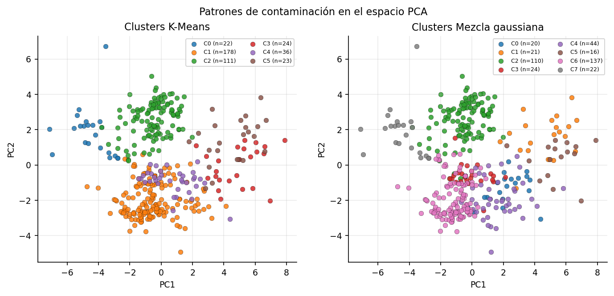

**Qué muestra.** Cada punto es una muestra, ubicada según sus dos primeras componentes principales (PC1 y PC2). La izquierda colorea los clusters de K-Means (k = 6); la derecha, los componentes de GMM (k = 8).

**Cómo se lee.**

- PC1 y PC2 explican **18.9 % + 16.0 % = 34.9 %** de la variabilidad total. Es una reducción importante: el gráfico es útil para ver estructura, pero no captura toda la información.
- Puntos cercanos tienen composiciones químicas parecidas.
- Los grupos no están perfectamente separados: hay solapamiento. Eso indica que los patrones son **graduales**, no categorías naturales perfectas.
- K-Means produce 6 grupos más interpretables; GMM fragmenta más (8 componentes), probablemente porque modela covarianzas complejas.

**Decisión que justifica.** Se usa K-Means de 6 clusters para la narrativa porque tiene mejor silueta y grupos más estables. GMM se reporta como análisis de sensibilidad, no como clasificación definitiva.

### 8.3 Elección del número de clusters

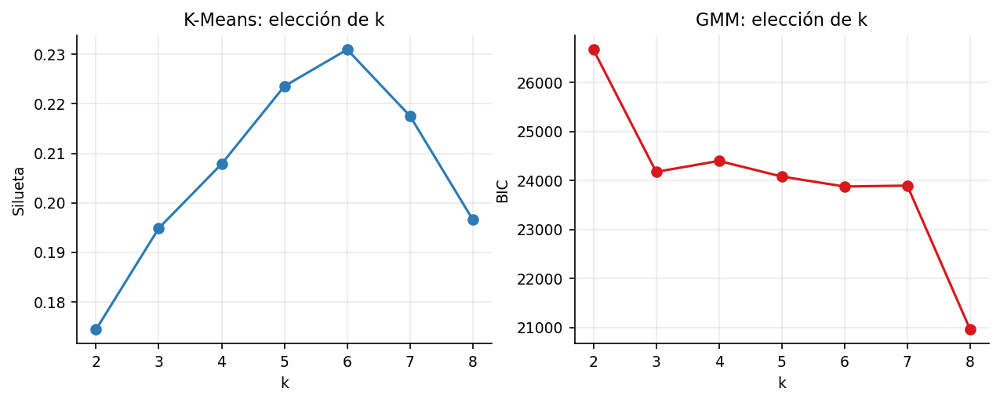

**Qué muestra.** Izquierda: silueta de K-Means para k = 2…8 (más alto es mejor). Derecha: BIC de GMM para k = 2…8 (más bajo es mejor).

**Cómo se lee.**

- K-Means alcanza su máximo en **k = 6**, con silueta **0.231**.
- GMM alcanza su mínimo de BIC en **k = 8**.
- Una silueta de 0.23 es **moderada-baja**: los grupos existen, pero no están muy separados. Es esperable en datos ambientales continuos.

**Decisión que justifica.** No hay un “k verdadero”. Se elige 6 por interpretabilidad y estabilidad, y se muestra que GMM preferiría 8. Los clusters son una herramienta descriptiva, no una verdad absoluta.

### 8.4 Perfil químico de cada cluster

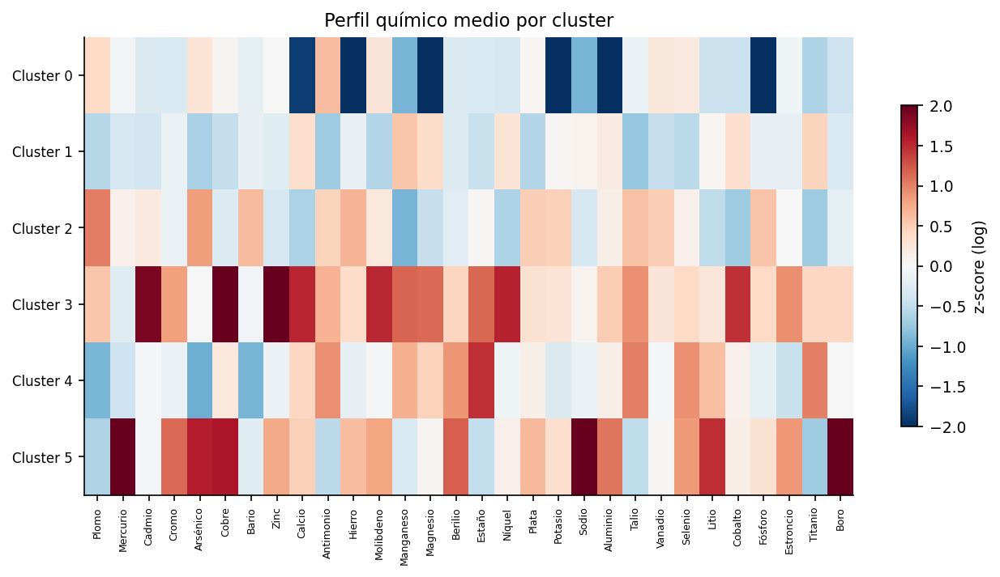

**Qué muestra.** Un mapa de calor con los 6 clusters en las filas y 30 variables químicas en las columnas. El color es el **z-score** de la concentración logarítmica media de cada cluster respecto a la media global.

**Cómo se lee.**

- **Rojo** = el cluster tiene, en promedio, valores por encima de la media global.
- **Azul** = valores por debajo.
- La intensidad indica cuántas desviaciones estándar se aleja.
- No es una concentración absoluta; es una posición relativa.

**Perfiles resumidos:**

| Cluster | n | Elementos dominantes | Elementos bajos | PLI mediano | Lectura |
|---|---:|---|---|---:|---|
| 0 | 22 | Sb, Pb, As, Mo | Al, Fe, K | 3.06 | Firma Sb–Pb–As–Mo con empobrecimiento de litogénicos |
| 1 | 178 | Mn, Ti, Mg, Ca | Tl, Sb, As | 1.25 | Firma de fondo/mineralogía; el grupo menos contaminado |
| 2 | 111 | Pb, As, Fe, Ba | Mn, Ti, Co | 4.29 | Firma Pb–As–Fe–Ba, típica de carga minera |
| 3 | 24 | Zn, Cu, Cd, Ni | Hg, Ba, As | 10.27 | Firma polimetálica Zn–Cu–Cd–Ni; el PLI más alto |
| 4 | 36 | Sn, Tl, Ti, Sb | As, Ba, Pb | 1.74 | Firma Sn–Tl–Ti–Sb, posible alteración hidrotermal |
| 5 | 23 | B, Hg, Na, Cu | Ti, Pb, Sb | 11.43 | Firma B–Hg–Na–Cu; PLI muy alto |

**Interpretación cluster por cluster:**

- **Cluster 1 (n = 178, 45 %):** es el grupo más grande y el más “normal”. Predominan Mn, Ti, Mg y Ca, elementos ligados a la mineralogía de fondo. Tiene el PLI mediano más bajo (1.25) y concentra 17 muestras Bajo, 64 Medio, 73 Alto y ninguna Muy alto. Es el grupo de referencia.
- **Cluster 2 (n = 111, 28 %):** firma **Pb–As–Fe–Ba**. Tiene PLI mediano 4.29, 84 muestras Alto y 25 Muy alto. 110 de sus 111 muestras son de Carumas (la restante, de Chojata). Es el patrón más claramente asociado a la zona minera del norte.
- **Cluster 3 (n = 24, 6 %):** firma **Zn–Cu–Cd–Ni**, con PLI mediano 10.27, el segundo más alto después del cluster 5. 14 muestras son Muy alto. Se distribuye entre Carumas (9), Torata (13) y Pacocha (2). Es un patrón polimetálico fuerte, compatible con sulfuros.
- **Cluster 4 (n = 36, 9 %):** firma **Sn–Tl–Ti–Sb**. PLI mediano 1.74; la mayoría son Medio (23) y Alto (11). 29 de 36 muestras son de Torata. Podría reflejar una firma geológica o de alteración distinta.
- **Cluster 5 (n = 23, 6 %):** firma **B–Hg–Na–Cu**, con PLI mediano 11.43 y 19 muestras Muy alto. Todas son de Carumas. La combinación de Hg y B es llamativa y merece verificación de campo.
- **Cluster 0 (n = 22, 6 %):** firma **Sb–Pb–As–Mo**, con Fe, Al y K bajos. PLI mediano 3.06; 17 Alto y 5 Muy alto. Es un grupo pequeño pero químicamente distinto.

**Cuidado con la interpretación.** Los clusters describen **asociaciones**, no fuentes comprobadas. Un cluster con Hg y B puede deberse a un proceso geológico, a una fuente industrial o a ambos. La hipótesis debe contrastarse con datos de campo.

### 8.5 Anomalías químicas

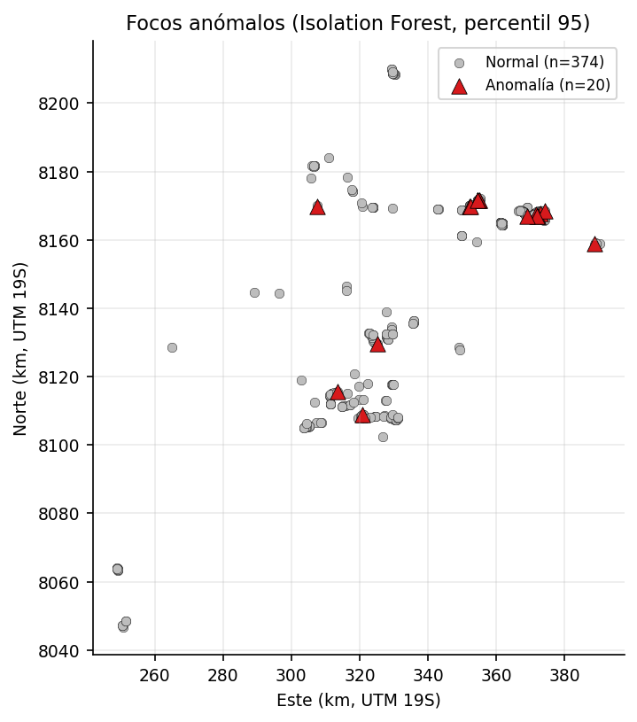

**Qué muestra.** Los puntos grises son muestras “normales” y los triángulos rojos son las **20 muestras anómalas** detectadas por Isolation Forest (percentil 95). El algoritmo busca muestras que son fáciles de aislar porque su combinación química es poco frecuente.

**Cómo se lee.**

- Hay 20 anomalías (5 % de las 394 muestras).
- Se distribuyen principalmente en Carumas y Torata, con algunos puntos en el corredor central.
- 14 de las 20 son **Muy alto**, 5 son **Alto** y 1 es **Bajo**. No todas las anomalías son de riesgo alto: una muestra puede ser químicamente rara pero no estar contaminada.
- Las anomalías son **candidatas a verificación**, no una lista de “culpables”.

**Diferencia con los clusters.** Un cluster es un grupo grande de muestras parecidas; una anomalía es una muestra que no encaja bien en ningún grupo. Ambos son complementarios.

---

## 9. Modelos supervisados

### 9.1 Qué se quiso predecir

Se plantearon dos tareas:

| Tarea | Variable objetivo | Pregunta |
|---|---|---|
| Regresión | `PLI_log = log1p(PLI)` | ¿Cuánta carga metálica tiene una muestra? |
| Clasificación | `excede_pel` | ¿La muestra supera el PEL de al menos un metal? |

**Por qué log1p(PLI).** El PLI es asimétrico y tiene valores extremos. La transformación logarítmica estabiliza la varianza y mejora el aprendizaje. Las métricas se reportan en escala logarítmica y, cuando es útil, en escala original del PLI.

**Por qué `excede_pel` y no `PLI > 1`.** `PLI > 1` tiene 79.7 % de positivos; un modelo que diga “siempre positivo” tendría una exactitud alta pero sería inútil. `excede_pel` tiene 66.5 % de positivos en toda la base y 72.8 % en la submuestra modelada; sigue siendo desbalanceado, pero es una pregunta normativa más clara y permite comparar con el nivel *Alto/Muy alto*.

### 9.2 La regla anti-fuga

El PLI se calcula con 8 metales: **As, Cd, Cr, Cu, Hg, Ni, Pb, Zn**. Si esos metales se usan como variables de entrada, el modelo podría “copiar” la respuesta y las métricas serían ficticias.

Por eso se estableció una **barrera dura**:

- prohibido usar los 8 metales del índice;
- prohibido usar cualquier derivada: `CF_*`, `Igeo_*`, `Bn_*`, `ratio_pel_*`, `n_metales_sobre_*`, `PLI`, `RI`, etc.;
- permitido usar litogénicos no normados, fisicoquímicos, ABA, orgánicos derivados, ratios y coordenadas/tiempo.

La regla se verifica en dos lugares:

1. `features.verificar_no_fuga()`: si algo prohibido entra, el pipeline se detiene.
2. `tests/test_no_leakage.py`: la suite falla si la barrera se rompe.

> **En palabras simples:** el modelo no puede usar la respuesta para predecir la respuesta. Debe aprender de señales indirectas del contexto geoquímico.

### 9.3 Variables de entrada

Los modelos usan **45 variables**:

- **Litogénicos y elementos mayores:** Al, Fe, Mn, Ca, Mg, K, Na, Ti, Sr, Li, Ba, V, Co, B, Be, Sn, Bi, Se, Mo, Sb, Tl, P, Si, U, Ce, Th, W.
- **Fisicoquímicos y ABA:** pH pasta, sulfato, sulfuro, cianuro total, potenciales de neutralización (Sobek, RNP, NNP, MPA).
- **Orgánicos derivados:** TPH total, suma PAH16, suma BTEX.
- **Ratios:** Ca/Mg, Mn/Fe, Fe/Al.
- **Espaciales y temporales:** coordenada Este, coordenada Norte, año, mes.

Las concentraciones asimétricas se transforman con log1p. La imputación de faltantes se hace **dentro** del pipeline, después de dividir los datos, para no filtrar información del conjunto de prueba.

### 9.4 Validación: cómo se evita engañarse

Con ~400 muestras, una sola partición puede dar resultados muy distintos. Se usaron tres esquemas:

| Esquema | Qué hace | Para qué |
|---|---|---|
| **GroupKFold repetido** | 5 folds × 5 semillas = 25 evaluaciones; los folds se agrupan por punto de muestreo | Métricas honestas sin fuga espacial |
| **Hold-out temporal** | Entrena con años ≤ 2023 y prueba con 2024–2026 | Simula predecir campañas futuras |
| **Bootstrap** | 1000 remuestreos del hold-out | Intervalo de confianza al 95 % |

**Por qué agrupar por punto.** Si un mismo punto cae en entrenamiento y prueba, el modelo puede memorizar su química y las métricas se inflan. Al agrupar, el modelo se evalúa en puntos que nunca vio.

**Por qué hold-out temporal.** Es el escenario real: el modelo se entrena con el pasado y se usa para el futuro. Es una prueba más exigente que la CV aleatoria.

### 9.5 Regresión del PLI

Se compararon cuatro modelos:

- **Media (baseline):** predice siempre la media. Sirve para saber si los modelos aportan algo.
- **Ridge:** regresión lineal regularizada.
- **Random Forest:** ensamble de árboles.
- **XGBoost:** boosting de gradientes.

| Modelo | R²(log) | RMSE(log) | MAE(log) | R²(PLI) |
|---|---:|---:|---:|---:|
| **XGBoost** | **0.823 ± 0.043** | **0.262** | **0.197** | **0.774** |
| Random Forest | 0.781 ± 0.046 | 0.292 | 0.222 | 0.689 |
| Ridge | 0.675 ± 0.087 | 0.354 | 0.279 | 0.606 |
| Media (baseline) | −0.031 ± 0.050 | 0.640 | 0.535 | −0.085 |

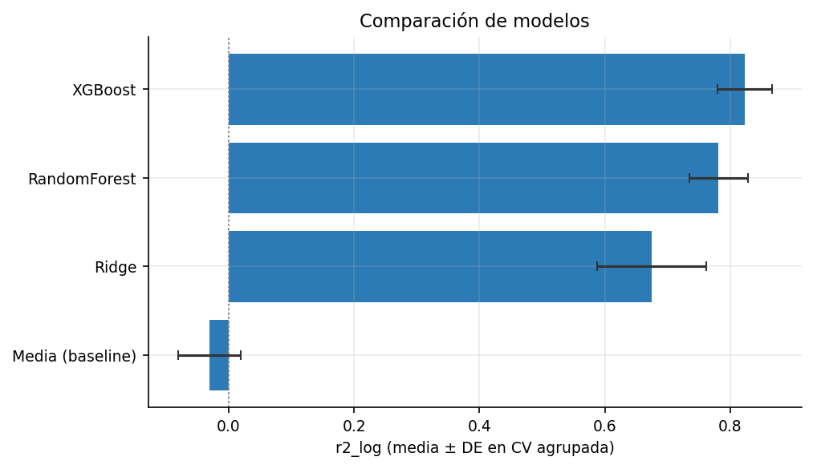

**Qué muestra.** Barras del R²(log) medio ± desviación estándar en las 25 evaluaciones. La línea punteada marca R² = 0.

**Cómo se lee.**

- XGBoost es el mejor: explica **82.3 %** de la varianza del log(PLI) en validación agrupada.
- Random Forest queda cerca (78.1 %).
- Ridge baja a 67.5 %, lo que sugiere relaciones no lineales.
- El baseline tiene R² negativo: predecir la media es peor que no hacer nada.

**Métricas complementarias.**

- **RMSE(log) = 0.262:** error promedio en escala logarítmica.
- **MAE(log) = 0.197:** error absoluto medio.
- **R²(PLI) = 0.774:** al volver a la escala original, el modelo explica 77.4 % de la varianza del PLI.

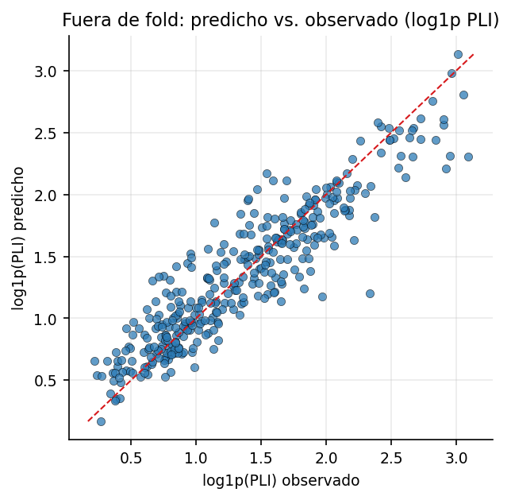

**Qué muestra.** Cada punto es una muestra. El eje X es el log1p(PLI) observado; el eje Y, el log1p(PLI) predicho por el modelo cuando esa muestra estaba fuera de entrenamiento. La línea roja punteada es la identidad (predicción perfecta).

**Cómo se lee.**

- La nube sigue la diagonal: el modelo captura la tendencia general.
- Hay más dispersión en valores altos (log1p > 2, es decir, PLI > 6.4). Es esperable: los extremos son pocos y difíciles.
- El R² fuera de fold es **0.841**, consistente con la CV.
- Algunos puntos se alejan de la diagonal; son los casos donde el contexto geoquímico no explica bien el PLI.

**Validación temporal.**

| Métrica | Valor |
|---|---:|
| R²(log) en 2024–2026 | **0.547** |
| RMSE(log) | 0.341 |
| MAE(log) | 0.257 |
| R²(PLI) | 0.239 |
| Media bootstrap R²(log) | **0.536 [0.300, 0.721]** |
| n train / test | 308 / 49 |

La caída de 0.823 a 0.547 es esperable: el hold-out temporal es más difícil y tiene solo 49 muestras. El intervalo de confianza es amplio, así que la cifra debe leerse como “explica alrededor de la mitad de la variabilidad futura”, no como un valor exacto.

### 9.6 Clasificación de excedencia del PEL

| Modelo | F1 | ROC-AUC | PR-AUC | Balanced accuracy |
|---|---:|---:|---:|---:|
| **Random Forest** | 0.955 ± 0.020 | **0.971 ± 0.024** | **0.984** | 0.912 |
| XGBoost | **0.961 ± 0.021** | 0.964 ± 0.028 | 0.980 | **0.929** |
| Regresión logística | 0.919 ± 0.035 | 0.940 ± 0.033 | 0.973 | 0.898 |
| Prior (baseline) | 0.845 ± 0.030 | 0.500 | 0.732 | 0.500 |

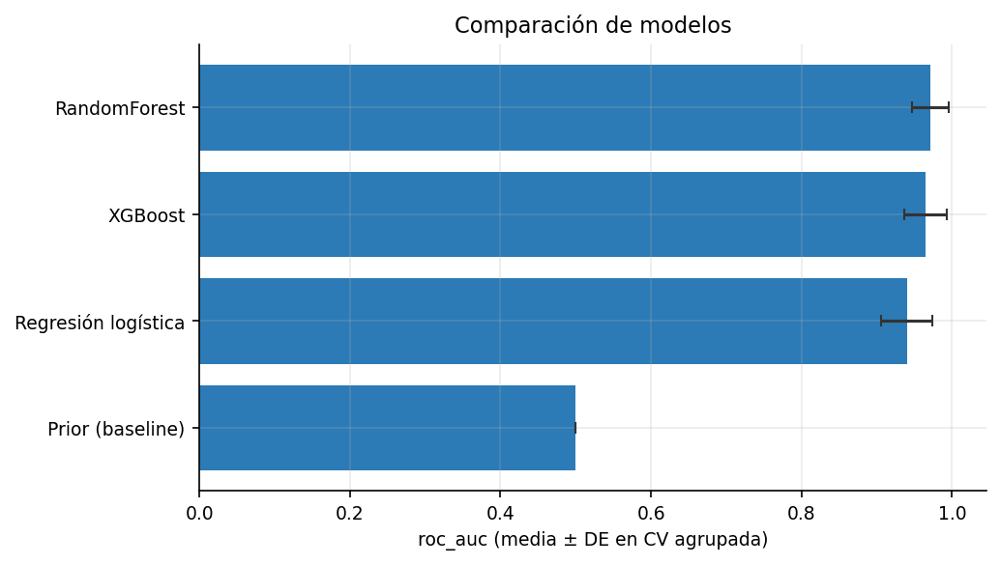

**Qué muestra.** Barras del ROC-AUC medio ± desviación estándar. Más alto es mejor; 0.5 es azar.

**Cómo se lee.**

- Random Forest tiene el mejor ROC-AUC (0.971); XGBoost tiene el mejor F1 (0.961) y balanced accuracy (0.929).
- La regresión logística también es buena (0.940), lo que indica que la señal es bastante separable.
- El baseline prior tiene ROC-AUC 0.5 porque predice siempre la clase mayoritaria.

**Por qué se elige Random Forest si XGBoost tiene mejor F1.** La métrica principal definida para clasificación es ROC-AUC, que mide la capacidad de ordenar probabilidades y no depende del umbral. Random Forest gana en esa métrica. XGBoost es una alternativa razonable si se prioriza F1.

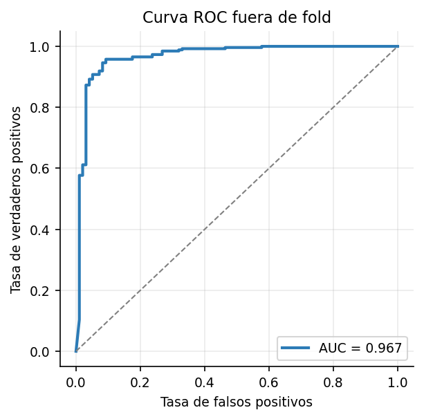

**Qué muestra.** La curva ROC del modelo de clasificación fuera de fold. El eje X es la tasa de falsos positivos; el eje Y, la tasa de verdaderos positivos. La diagonal gris representa el azar.

**Cómo se lee.**

- La curva se acerca a la esquina superior izquierda: el modelo separa bien las muestras que exceden el PEL de las que no.
- **AUC = 0.967** fuera de fold.
- Con umbral 0.5, la matriz de confusión es: 249 verdaderos positivos, 85 verdaderos negativos, 12 falsos positivos y 11 falsos negativos.
- El hold-out temporal da **AUC = 0.946 [0.872, 0.993]**, también alto.

**Precaución.** Un AUC alto no significa que el modelo “entienda” la contaminación. Los litogénicos (Fe, Al, Mn) covarían con la carga metálica, así que el modelo aprende **proxies**. Es útil para priorizar, no para probar causalidad.

---

## 10. Explicación con SHAP

### 10.1 Qué es SHAP

SHAP (*SHapley Additive exPlanations*) es una técnica que reparte la predicción de un modelo entre sus variables. Para cada muestra, dice **cuánto sumó o restó cada variable** a la predicción final.

- Un SHAP positivo empuja la predicción **hacia arriba** (mayor PLI).
- Un SHAP negativo la empuja **hacia abajo**.
- La magnitud indica la fuerza del efecto.
- SHAP explica **el modelo**, no el mundo real.

### 10.2 Importancia global

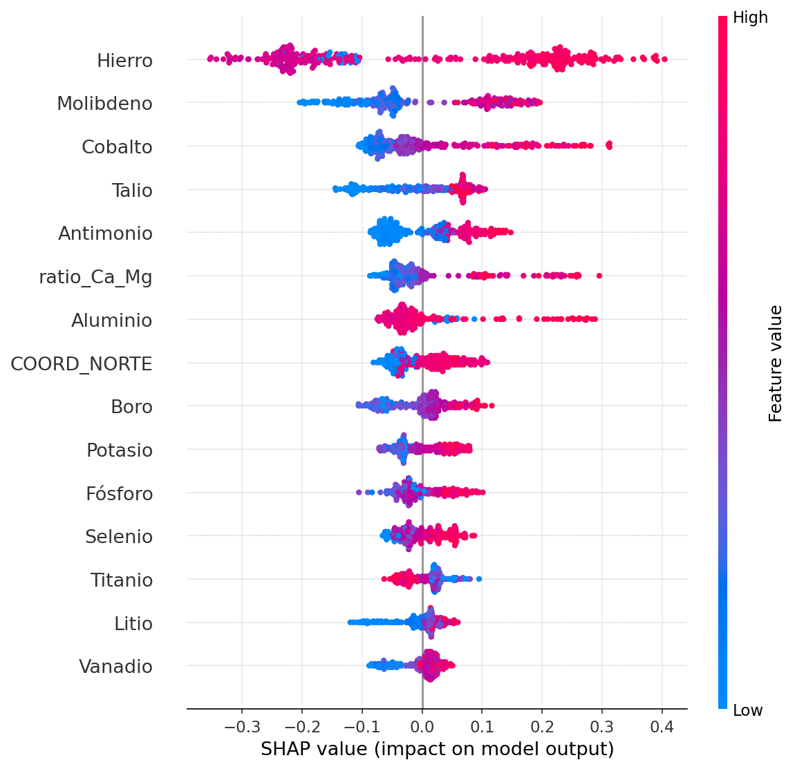

**Qué muestra.** Cada punto es una muestra. El eje X es el valor SHAP (impacto sobre la predicción). El color representa el valor de la variable: rojo = alto, azul = bajo. Las variables están ordenadas por importancia media absoluta.

**Cómo se lee.**

- **Hierro (Fe):** es la variable más importante. Valores altos (rojo) se desplazan a la derecha: aumentan la predicción. Valores bajos (azul) la disminuyen.
- **Molibdeno (Mo):** valores altos empujan hacia arriba; el efecto es claro pero menor que Fe.
- **Cobalto (Co):** valores altos aumentan la predicción.
- **Talio (Tl):** valores altos aumentan; los bajos la reducen.
- **Antimonio (Sb):** patrón similar, con más dispersión.
- **ratio_Ca_Mg:** valores altos aumentan la predicción.
- **Aluminio (Al):** valores altos tienden a **disminuir** la predicción. Una posible lectura es el efecto de dilución de aluminosilicatos: más Al implica menor proporción de minerales portadores de metales.
- **COORD_NORTE:** la ubicación norte (Carumas) se asocia con mayor PLI.

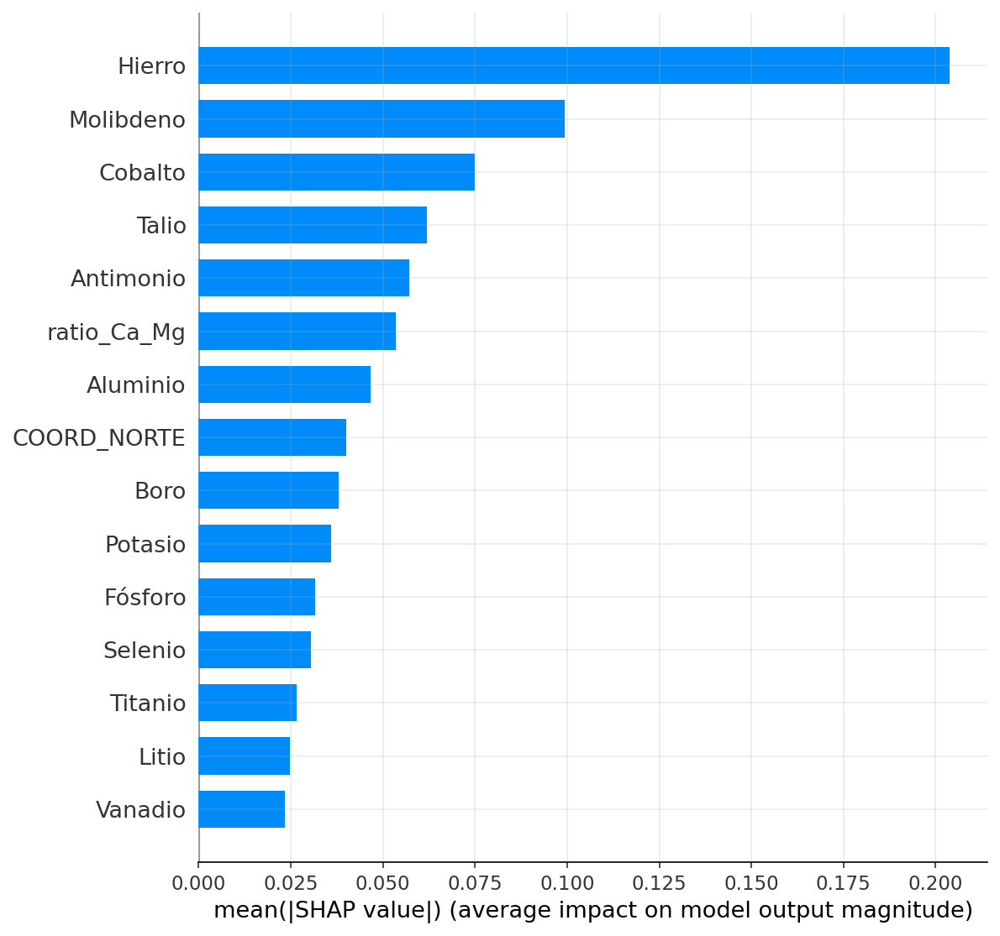

**Qué muestra.** La media del valor absoluto de SHAP para cada variable. Es una medida de importancia global: cuánto cambia la predicción, en promedio, al mover esa variable.

**Cómo se lee.**

- Fe: **0.204**.
- Mo: **0.099**.
- Co: **0.075**.
- Tl: **0.062**.
- Sb: **0.057**.
- Después vienen ratio_Ca_Mg (0.053), Al (0.047), COORD_NORTE (0.040), B (0.038), K (0.036).

La caída después de Fe muestra que hay una variable dominante y un grupo de trazadores secundarios.

### 10.3 Control por permutación

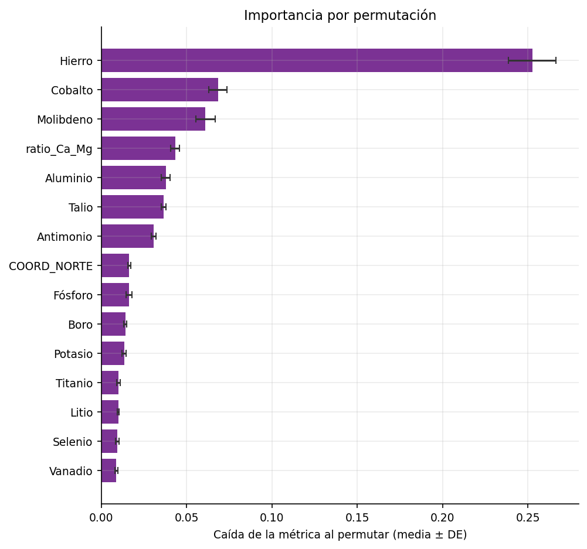

**Qué muestra.** Cuánto cae el R² del modelo cuando se desordena aleatoriamente una variable. Si la caída es grande, la variable es importante. Las barras muestran la media ± desviación estándar en 10 repeticiones.

**Cómo se lee.**

- Fe es, de nuevo, la variable más importante (caída media 0.252).
- Co (0.068), Mo (0.061), ratio_Ca_Mg (0.043), Al (0.038), Tl (0.036), Sb (0.031) le siguen.
- La concordancia entre el top-10 de SHAP y el top-10 de permutación es **9 de 10**. Eso indica que la explicación no depende de una sola técnica.

**Diferencia entre SHAP y permutación.** SHAP reparte la predicción muestra a muestra; permutación mide cuánto empeora el modelo global al destruir una variable. Son enfoques distintos; que coincidan da confianza.

### 10.4 Dependencia: cómo cambia el efecto

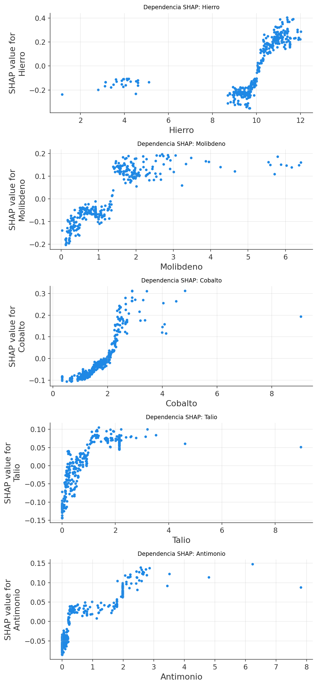

**Qué muestra.** Para cada variable, el eje X es el valor de la variable (en escala log1p para concentraciones) y el eje Y es su valor SHAP. Cada punto es una muestra.

**Cómo se lee.**

- **Fe:** el efecto no es lineal. Hay un salto alrededor de log1p(Fe) ≈ 9–10: por encima de cierto nivel, el Fe empuja fuerte la predicción. Eso sugiere un umbral mineralógico.
- **Mo:** el efecto sube rápido al principio y luego se estabiliza; los valores altos siguen sumando, pero con rendimientos decrecientes.
- **Co:** aumento sostenido hasta log1p(Co) ≈ 3–4; después se dispersa.
- **Tl:** sube rápido y se aplana; los valores muy altos no siempre implican más SHAP.
- **Sb:** patrón escalonado, con un salto alrededor de log1p(Sb) ≈ 2.

Estas formas no lineales explican por qué XGBoost supera a Ridge: las relaciones ambientales no son lineales.

### 10.5 Waterfalls: tres muestras críticas

Los *waterfalls* muestran cómo se construye la predicción de una muestra individual, desde el valor base hasta la predicción final.

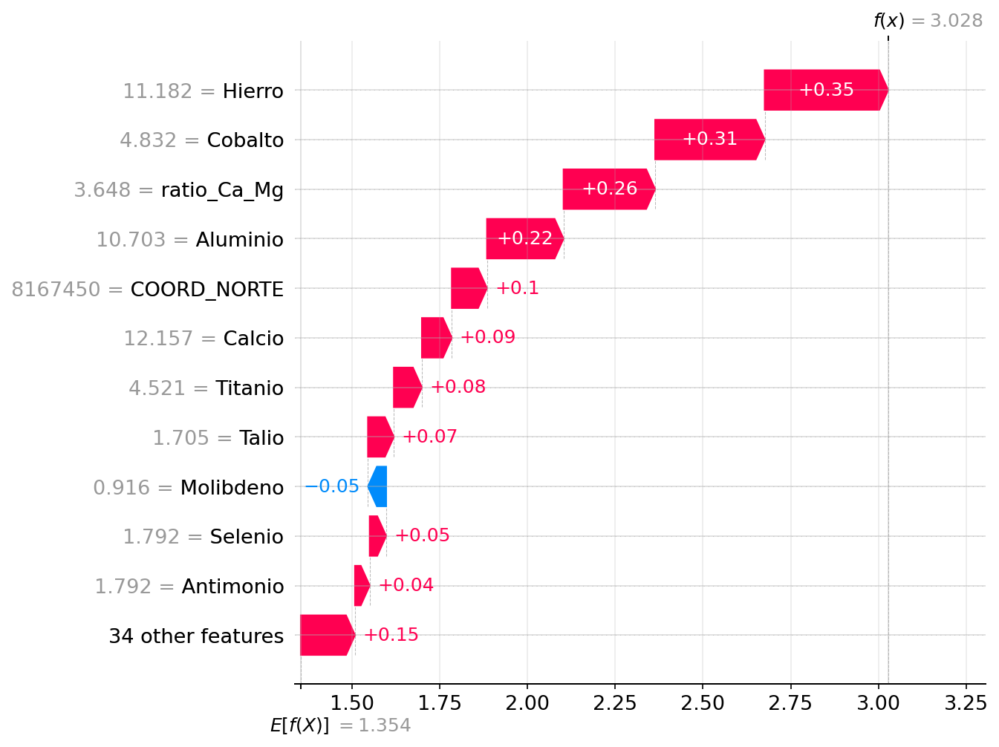

**Qué muestra.** La predicción final `f(x) = 3.028` (log1p(PLI) ≈ 3.03, es decir, PLI ≈ 19.7) se construye sumando contribuciones. El valor base `E[f(X)] = 1.354` es la predicción media del modelo.

**Cómo se lee.**

- Fe suma +0.35.
- Co suma +0.31.
- ratio_Ca_Mg suma +0.26.
- Al suma +0.22.
- COORD_NORTE suma +0.10.
- Calcio +0.09, titanio +0.08, talio +0.07, selenio +0.05 y antimonio +0.04.
- Mo resta −0.05.
- Las 34 variables restantes suman +0.15.

Es una muestra con una combinación de Fe, Co y ratio Ca/Mg que el modelo asocia con PLI alto.

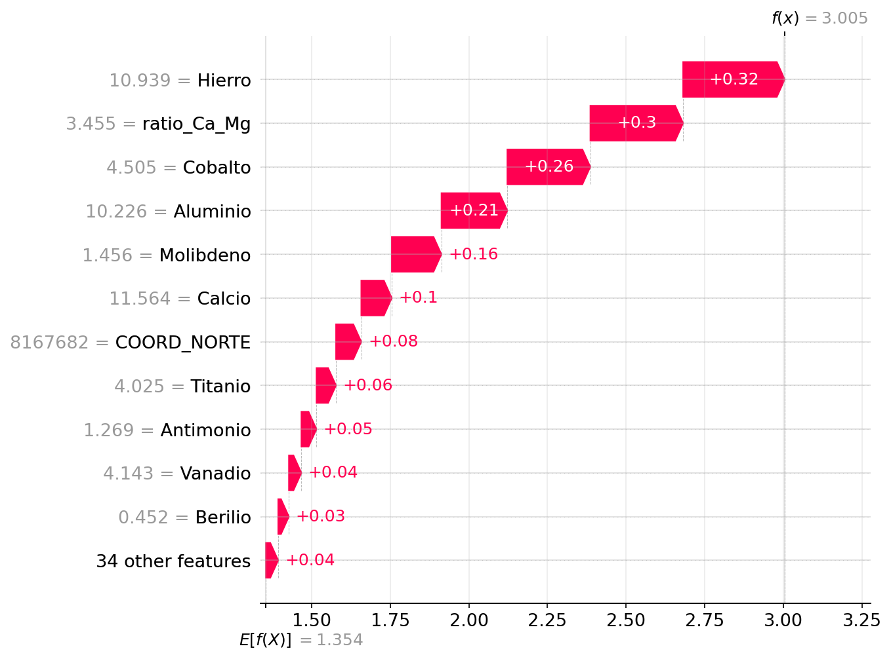

**Qué muestra.** Predicción `f(x) = 3.005` (PLI ≈ 19.2).

**Cómo se lee.**

- Fe +0.32.
- ratio_Ca_Mg +0.30.
- Co +0.26.
- Al +0.21.
- Mo +0.16.
- Calcio +0.10.
- COORD_NORTE +0.08.
- Titanio, antimonio, vanadio y berilio suman contribuciones menores.
- El bloque de 34 variables restantes, +0.04.

La muestra 2 tiene un peso mayor de la relación Ca/Mg y del Mo que la muestra 1.

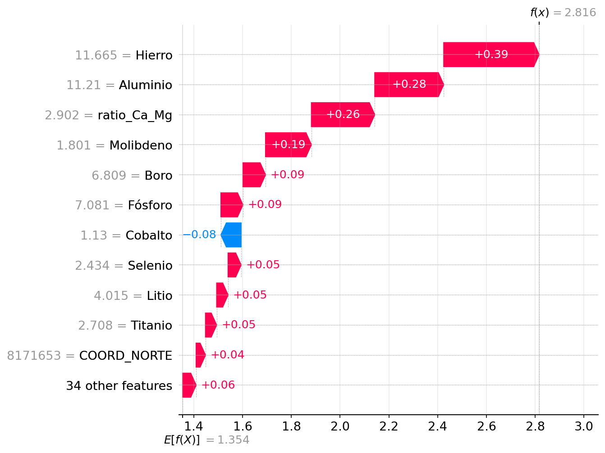

**Qué muestra.** Predicción `f(x) = 2.816` (PLI ≈ 15.7).

**Cómo se lee.**

- Fe +0.39.
- Al +0.28.
- ratio_Ca_Mg +0.26.
- Mo +0.19.
- B +0.09.
- P +0.09.
- Co **resta** −0.08.
- Selenio, litio y titanio suman +0.05 cada uno; COORD_NORTE, +0.04.
- Las 34 variables restantes suman +0.06.

En esta muestra el Al no actúa como diluyente: suma. Eso recuerda que SHAP es local: una variable puede tener un efecto distinto según el contexto de la muestra.

### 10.6 Lectura geoquímica

La combinación **Fe–Mo–Co–Tl–Sb** es coherente con un sistema mineralizado de tipo **pórfido/epitermal**:

- El **Fe** es una fase portadora (óxidos, sulfuros) y aparece en casi todas las muestras con PLI alto.
- **Mo, Co, Tl y Sb** son trazadores de alteración hidrotermal y de mineralización polimetálica.
- El **ratio Ca/Mg** puede reflejar fases carbonatadas o evaporíticas que covarían con la mineralización.
- El **Al** suele actuar como diluyente de aluminosilicatos, aunque en algunas muestras su efecto cambia.

Ninguno de los 8 metales del índice entra al modelo. La señal proviene del **contexto litogénico**, no de una fuga. Eso hace que el resultado sea más interesante: el modelo aprende a reconocer el “ambiente” geoquímico asociado a la carga metálica.

---

## 11. Zonas críticas

### 11.1 Cómo se agregaron las zonas

Los puntos individuales son útiles, pero para gestión ambiental conviene hablar de **zonas**. Se agregaron las 394 muestras en celdas UTM de **5 × 5 km**:

```text
celda = (piso(COORD_ESTE / 5000), piso(COORD_NORTE / 5000))
```

Cada celda resume:

- número de muestras;
- número de puntos distintos;
- PLI mediano y máximo;
- porcentaje de muestras en nivel Alto/Muy alto;
- intervalo de confianza de Wilson al 95 %;
- máximo número de metales sobre PEL;
- metal dominante normativo;
- rango de años.

**Por qué Wilson.** Una celda con una sola muestra al 100 % de excedencia no debería desplazar a una zona con 68 puntos y 95 % de excedencia. El límite inferior del IC de Wilson penaliza las celdas con pocos datos y hace el ranking más robusto.

**Orden del ranking:**

1. severidad normativa (Muy alto > Alto > Medio > Bajo);
2. límite inferior del IC95 de Wilson;
3. número de puntos;
4. PLI mediano.

### 11.2 Resultados

Las **15 celdas** del ranking son **todas Muy alto** y cubren **230 muestras (58 % del total)**: **12 en Carumas** y **3 en Torata**.

| Celda 5 km | Distrito | Muestras | Puntos | PLI mediano | % Alto/Muy alto | IC95 inf. | Máx. metales > PEL | Metal dominante |
|---|---|---:|---:|---:|---:|---:|---:|---|
| `74_1633` | Carumas | 79 | 68 | 3.86 | 94.9 | 87.6 | 5 | Arsénico |
| `73_1633` | Carumas | 37 | 33 | 3.79 | 97.3 | 86.2 | 4 | Arsénico |
| `70_1634` | Carumas | 24 | 14 | 4.11 | 100.0 | 86.2 | 3 | Arsénico |
| `72_1632` | Carumas | 19 | 10 | 3.69 | 100.0 | 83.2 | 3 | Arsénico |
| `70_1633` | Carumas | 9 | 6 | 4.25 | 100.0 | 70.1 | 3 | Arsénico |
| `71_1634` | Carumas | 8 | 4 | 1.19 | 100.0 | 67.6 | 3 | Arsénico |
| `61_1636` | Carumas | 6 | 6 | 4.70 | 100.0 | 61.0 | 3 | Arsénico |
| `64_1633` | Carumas | 6 | 4 | 5.21 | 100.0 | 61.0 | 3 | Arsénico |
| `63_1634` | Carumas | 3 | 3 | 3.64 | 100.0 | 43.8 | 3 | Arsénico |
| `69_1633` | Carumas | 2 | 2 | 2.49 | 100.0 | 34.2 | 3 | Arsénico |
| `61_1633` | Carumas | 2 | 1 | 11.75 | 100.0 | 34.2 | 5 | Arsénico |
| `63_1622` | Torata | 6 | 6 | 1.70 | 66.7 | 30.0 | 5 | Plomo |
| `62_1622` | Torata | 11 | 9 | 3.24 | 54.5 | 28.0 | 4 | Cobre |
| `64_1621` | Torata | 17 | 14 | 1.54 | 41.2 | 21.6 | 4 | Cobre |
| `62_1636` | Carumas | 1 | 1 | 14.29 | 100.0 | 20.7 | 4 | Arsénico |

**Lectura.**

- Las celdas más robustas son `74_1633`, `73_1633`, `70_1634` y `72_1632`: tienen muchos puntos, PLI mediano alto y un IC95 inferior > 83 %.
- `74_1633` es la más importante: 79 muestras, 68 puntos, 94.9 % en Alto/Muy alto y 5 metales sobre PEL.
- `61_1633` tiene el PLI mediano más alto (11.75), pero solo 1 punto: es un indicio, no una zona consolidada.
- `62_1636` tiene PLI 14.29 pero una sola muestra: mismo cuidado.
- En Carumas domina el **arsénico** (12 celdas); en Torata dominan **plomo** (`63_1622`) y **cobre** (`62_1622`, `64_1621`).

### 11.3 Puntos críticos

El ranking de puntos individuales usa la misma lógica normativa. Los primeros son:

| Punto | Distrito | PLI | Metales > PEL | Metal dominante |
|---|---|---:|---:|---|
| `ESP-SED-TJ-1` | Carumas | 20.98 | 5 | Arsénico |
| `ESP-40-SED` | Carumas | 18.19 | 5 | Zinc |
| `ESP-SED-21` | Carumas | 17.57 | 3 | Arsénico |
| `ESP-SED-22` | Carumas | 14.29 | 4 | Arsénico |
| `ESP-SUE-5` | Torata | 14.28 | 4 | Cobre |

Estos puntos deben priorizarse para verificación de campo. Pero un punto aislado no define una zona; por eso el ranking de celdas es el que se usa para gestión.

### 11.4 Mapa de focos

El mapa interactivo está en:

```text
reports/mapa_focos.html
```

Es un archivo autocontenido (Folium + Leaflet) que se abre en cualquier
navegador, sin servidor ni dependencias externas. El mapa base es el lienzo
claro de Esri con etiquetas de referencia; se evita OpenStreetMap porque bloquea
sus teselas cuando el HTML se abre con `file://`. El panel superior derecho
permite cambiar la variable que colorea los puntos y superponer capas:

| Grupo | Capas |
|---|---|
| Observado | riesgo normativo CCME (por defecto), PLI observado |
| Patrones (no son riesgo) | cluster K-Means, cluster GMM |
| Predicho | PLI predicho, probabilidad de exceder ≥ 1 PEL, clase predicha |

Tres decisiones evitan lecturas engañosas:

- **Los clusters no son niveles de riesgo.** La paleta de clusters es distinta
  de la escala CCME y la leyenda lo indica de forma explícita. Un cluster
  describe una firma química —por ejemplo, Sb–Pb–As–Mo— y puede contener
  muestras de riesgo bajo y muy alto a la vez.
- **Las predicciones son honestas.** Para las 357 muestras con predicción se usa
  la predicción fuera de fold (OOF), generada por un modelo que nunca vio la
  muestra. Si el archivo OOF no está disponible, se recurre al modelo final y
  el popup lo etiqueta como `modelo final (in-sample)`. El PLI OOF se convierte
  de la escala `log1p` con `expm1` antes de mapearlo. Las 37 muestras sin
  variables suficientes quedan en gris y sin predicción.
- **La clase predicha no es un nivel normativo.** Es la salida binaria del
  clasificador (`excede ≥ 1 PEL` / `no excede`) con umbral 0,5; no reemplaza la
  escala CCME de cuatro niveles.

La casilla de anomalías superpone 20 anillos negros discontinuos (Isolation
Forest, percentil 95). Una anomalía química no equivale a riesgo alto: puede ser
un valor atípico de un metal no normado. Las celdas de 5 × 5 km se pueden
mostrar como top 15 críticas o como las 57 celdas con datos; su geometría se
reconstruye con las cuatro esquinas UTM de `GRID_5KM` y se reproyecta a
lat/lon, no como un rectángulo aproximado.

El popup de cada muestra reúne punto, distrito, fecha, nivel CCME, PLI, RI,
metales sobre PEL/ISQG, metal dominante normativo, metal enriquecido por CF,
clusters K-Means y GMM, anomalía y predicciones con su fuente. Es la versión
interactiva de las figuras 7 y 8 y mantiene la misma paleta y el mismo popup
enriquecido del tablero de Streamlit; el tablero conserva la vista simple por
riesgo y ofrece la descarga del HTML completo con todas las capas.

---

## 12. Tablero, pruebas y reproducibilidad

### 12.1 Tablero

El tablero se ejecuta con:

```bash
streamlit run app/streamlit_app.py
```

Tiene cinco pantallas:

1. **Resumen:** KPIs, distribución del nivel de riesgo y metales sobre PEL.
2. **Mapa:** puntos coloreados por nivel normativo, con filtros, popup enriquecido y descarga del HTML completo con capas de clusters, predicciones, anomalías y celdas.
3. **Ranking:** puntos críticos, zonas de 5 × 5 km, metal dominante normativo, metal enriquecido por CF y variable SHAP dominante.
4. **Modelo:** métricas de CV, hold-out, bootstrap, SHAP y permutación.
5. **Datos:** explorador, calidad de datos y descarga del subconjunto filtrado.

El tablero es de **solo lectura**: consume los artefactos del pipeline, no reentrena.

### 12.2 Pruebas

```bash
python -m pytest -q
```

Resultado: **23 pruebas aprobadas**.

- `tests/test_no_leakage.py`: los 8 metales del índice y sus derivadas nunca entran como features; `verificar_no_fuga` aborta; ninguna feature reproduce el PLI.
- `tests/test_indices.py`: PLI = media geométrica de CF, Igeo = log2(CF/1.5), RI ponderado por toxicidad, mínimo de 4 metales, cortes de nivel y coherencia PEL > ISQG.
- `tests/test_report.py`: las zonas se agregan y ordenan por severidad; `top=None` devuelve todas las celdas; el ranking usa `metal_dominante_normativo` y conserva el CF como columna aparte; la geometría de 5 × 5 km usa cuatro esquinas UTM; el mapa genera capas, leyendas y controles; las predicciones se unen por `id_muestra`.

### 12.3 Reproducibilidad

`config/run_config.json` registra:

- fecha de ejecución;
- versiones de Python, pandas, numpy y scikit-learn;
- semillas (42, 7, 2026, 1234, 99);
- número de folds;
- sha256 del CSV crudo;
- método de censura;
- percentil de fondo;
- metales del índice;
- umbrales de cobertura;
- año de corte temporal.

Para reconstruir todo desde el CSV:

```bash
python run_pipeline.py --sin-cache
```

**Nota para clones.** El CSV crudo (~98 MB) y los archivos intermedios no se versionan por tamaño. Descarga `Monitoreos_SEDIMENTO.csv` del portal de datos abiertos del OEFA y guárdalo en `data/raw/`. Los artefactos de `data/processed/`, `models/` y `reports/` sí se incluyen, de modo que el tablero funciona sin reentrenar.

---

## 13. Limitaciones

Ningún resultado debe leerse sin estas advertencias.

1. **Muestreo no probabilístico.** Las campañas del OEFA priorizan zonas de influencia minera. Los porcentajes (79.7 % PLI > 1, 66.5 % > PEL) describen la **muestra analizada**, no la prevalencia de todo Moquegua.
2. **Datos censurados.** La imputación LD/2 es estándar, pero introduce sesgo. El análisis de sensibilidad muestra que el ranking es estable, pero los valores absolutos pueden cambiar.
3. **Fondo geoquímico.** El P25 local es una aproximación. No sustituye un estudio de línea base con testigos de referencia, datación o mineralogía.
4. **Deriva temporal.** El hold-out 2024–2026 tiene solo 49 muestras. El IC bootstrap [0.300, 0.721] es amplio; la cifra de 0.547 no es exacta.
5. **Causalidad.** SHAP explica el modelo, no el mecanismo ambiental. Las hipótesis de fuente (minería, geología, hidrotermalismo) requieren verificación de campo.
6. **Resolución espacial.** 193 puntos para todo un departamento es poco. El mapa muestra puntos, no superficies continuas de riesgo.
7. **Clusters moderados.** La silueta de 0.231 indica grupos poco separados. Los patrones son una herramienta descriptiva, no una taxonomía natural.
8. **PAH con baja cobertura.** Los PAH aparecen en la figura de excedencias, pero tienen ~35 muestras y censura alta. No se usan para el nivel de riesgo.
9. **Dos definiciones de metal dominante.** El CF y la presión normativa pueden discrepar (por ejemplo, Hg por CF vs As por PEL). El informe usa la lectura normativa para gestión y conserva el CF para enriquecimiento relativo.

---

## 14. Conclusiones

1. **La contaminación es extensa.** El 79.7 % de las muestras tiene PLI > 1 y el 66.5 % supera al menos un PEL. No es un fenómeno puntual.
2. **El arsénico es el contaminante más crítico.** El 88.0 % supera ISQG y el 64.6 % supera PEL. Le siguen cobre, mercurio y plomo.
3. **El riesgo se concentra espacialmente.** Las 15 celdas críticas de 5 × 5 km son todas Muy alto y cubren 230 muestras; 12 están en Carumas y 3 en Torata.
4. **Hay seis patrones químicos.** Los clusters 3 (Zn–Cu–Cd–Ni) y 5 (B–Hg–Na–Cu) tienen los PLI más altos; el cluster 1 (Mn–Ti–Mg–Ca) es el fondo.
5. **Los modelos predicen bien.** XGBoost alcanza R²(log) = 0.823 en CV y 0.547 en hold-out temporal; Random Forest alcanza ROC-AUC = 0.971 en CV y 0.946 en hold-out.
6. **La señal es geoquímica, no una fuga.** Fe, Mo, Co, Tl y Sb son las variables más influyentes; ninguna pertenece a los 8 metales del índice. El patrón es compatible con un sistema mineralizado.
7. **El producto es usable.** Pipeline reproducible, 23 pruebas, tablero de 5 pantallas, mapas y tablas exportables.
8. **El siguiente paso es la validación de campo.** Las zonas y anomalías deben verificarse con muestreo dirigido, análisis mineralógico y, si es posible, isótopos o modelamiento de fuentes.

---

## 15. Glosario breve

| Término | Significado sencillo |
|---|---|
| **Muestra** | Porción de sedimento recogida en un punto y fecha. |
| **Punto de muestreo** | Lugar físico donde se recoge la muestra. |
| **PLI** | Índice que resume el enriquecimiento de varios metales. |
| **CF** | Cuántas veces supera un metal el fondo local. |
| **Igeo** | Índice de geoacumulación; parecido al CF pero en escala log2. |
| **RI** | Índice de riesgo ecológico; pondera por toxicidad. |
| **ISQG** | Nivel de efecto umbral de una guía de calidad. |
| **PEL** | Nivel de efecto probable; más alto que ISQG. |
| **Bn** | Fondo geoquímico local usado como referencia. |
| **Clúster** | Grupo de muestras químicamente parecidas. |
| **Anomalía** | Muestra que no encaja en el patrón general. |
| **R²** | Proporción de la variabilidad explicada por el modelo. |
| **RMSE** | Error cuadrático medio; penaliza errores grandes. |
| **MAE** | Error absoluto medio; más fácil de interpretar. |
| **ROC-AUC** | Capacidad de ordenar positivos y negativos; 0.5 = azar. |
| **F1** | Equilibrio entre precisión y recall. |
| **CV** | Validación cruzada; varias particiones para medir estabilidad. |
| **Hold-out** | Conjunto separado para probar el modelo. |
| **Bootstrap** | Remuestreo para estimar un intervalo de confianza. |
| **SHAP** | Técnica que reparte una predicción entre sus variables. |
| **GroupKFold** | CV que mantiene juntos los grupos (p. ej., un punto). |

---

## 16. Anexo: figuras y archivos

### 16.1 Figuras incluidas

| Figura | Archivo | Sección |
|---|---|---|
| 1 | `figures/01_cobertura_parametros.png` | 5.1 |
| 2 | `figures/02_censura_parametros.png` | 5.2 |
| 3 | `figures/03_distribuciones.png` | 5.3 |
| 4 | `figures/04_correlaciones.png` | 5.4 |
| 5 | `figures/19_excedencias.png` | 6.7 |
| 6 | `figures/20_nivel_riesgo.png` | 7.2 |
| 7 | `figures/07_mapa_pli.png` | 7.4 |
| 8 | `figures/07_mapa_nivel_riesgo.png` | 7.4 |
| 9 | `figures/06_serie_temporal.png` | 7.5 |
| 10 | `figures/05_pli_por_distrito.png` | 7.6 |
| 11 | `figures/09_pca_clusters.png` | 8.2 |
| 12 | `figures/10_seleccion_k.png` | 8.3 |
| 13 | `figures/11_perfil_clusters.png` | 8.4 |
| 14 | `figures/08_mapa_anomalias.png` | 8.5 |
| 15 | `figures/12_comparacion_modelos_regresion.png` | 9.5 |
| 16 | `figures/13_predicho_vs_real.png` | 9.5 |
| 17 | `figures/12_comparacion_modelos_clasificacion.png` | 9.6 |
| 18 | `figures/14_curva_roc.png` | 9.6 |
| 19 | `figures/16_shap_summary_regresion_pli.png` | 10.2 |
| 20 | `figures/17_shap_bar_regresion_pli.png` | 10.2 |
| 21 | `figures/15_importancia_permutacion.png` | 10.3 |
| 22 | `figures/18_shap_dependence_regresion_pli.png` | 10.4 |
| 23 | `figures/19_shap_waterfall_regresion_pli_1.png` | 10.5 |
| 24 | `figures/19_shap_waterfall_regresion_pli_2.png` | 10.5 |
| 25 | `figures/19_shap_waterfall_regresion_pli_3.png` | 10.5 |

### 16.2 Tablas y datos

| Archivo | Contenido |
|---|---|
| `reports/tables/log_filtros_carga.csv` | Filtro nacional → Moquegua |
| `reports/tables/log_limpieza.csv` | Reglas R1–R10 y filas eliminadas |
| `reports/tables/cobertura_parametros.csv` | Cobertura de los 91 parámetros |
| `reports/tables/censura_por_parametro.csv` | Porcentaje de censura |
| `reports/tables/metricas_cv_regresion_pli.csv` | Métricas de regresión |
| `reports/tables/metricas_cv_clasificacion_riesgo.csv` | Métricas de clasificación |
| `reports/tables/holdout_regresion_pli.csv` | Hold-out temporal de regresión |
| `reports/tables/holdout_clasificacion_riesgo.csv` | Hold-out temporal de clasificación |
| `reports/tables/perfil_clusters.csv` | Perfil resumido de clusters |
| `reports/tables/perfil_clusters_z.csv` | z-scores por cluster y variable |
| `reports/tables/zonas_criticas.csv` | Ranking de celdas de 5 × 5 km |
| `reports/tables/ranking_puntos_criticos.csv` | Ranking de puntos |
| `reports/tables/sensibilidad_fondo.csv` | P10/P25/P50/corteza |
| `reports/tables/sensibilidad_censura.csv` | LD/2, LD/√2, LD |
| `reports/tables/shap_importancia_regresion_pli.csv` | Importancia SHAP |
| `reports/tables/importancia_permutacion_regresion_pli.csv` | Importancia por permutación |
| `data/processed/dataset_final.csv` | Dataset final con índices, clusters y predicciones |
| `reports/mapa_focos.html` | Mapa interactivo |

### 16.3 Cómo regenerar

```bash
# 1. Activar entorno
.venv\Scripts\activate

# 2. Pipeline completo
python run_pipeline.py

# 3. Solo datos
python run_pipeline.py --solo-datos

# 4. Tablero
streamlit run app/streamlit_app.py

# 5. Pruebas
python -m pytest -q
```

---

**Fin del informe.**
